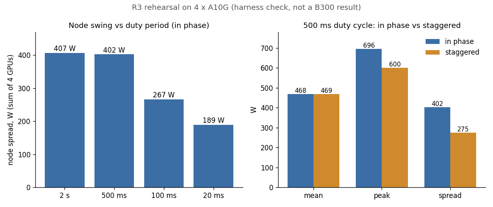

# Eight B300s that nvidia-smi liked and CUDA wouldn't touch

[gpu-power-lab](https://github.com/sinkers/gpu-power-lab) measures how hard
and how fast a datacentre GPU can swing its power draw. The first two rounds
ran on a single B300. R3 is the node round: eight GPUs driven together, in
phase and deliberately staggered, to see what the whole node does to the
supply. This is the day it was meant to start, and why it didn't.

## Rehearse on cheap hardware first

Before booking eight B300s I ran the whole R3 campaign on a `g5.12xlarge`
spot instance: four A10Gs, about an hour, about $2. The numbers from it are
not a result. An A10G is a 300 W Ampere part and the power virus is written
for Blackwell tensor cores, so it only reaches about 175 W. The point was the
harness.

It found five defects, and four of them produced plausible output rather
than an error:

1. CMake silently failed to find NCCL on a Deep Learning AMI.
2. The collator summed the driver-averaged power field, which flattened
   every swing. In-phase and staggered read 0.959 and 0.938, which
   distinguishes nothing.
3. A deliberate stagger was reported as a barrier failure.
4. The fixed barrier lead time was 5 s short on a cold cache, so every
   device missed it.
5. The barrier undid warmup. Devices idled back to 74 W while they waited,
   and a no-duty rung showed 410 W of spread that was all ramp.

After the fixes every barrier held to 33–114 ms and every rung produced a
node curve. The staggered control did what it's for: the same mean power to
within 1 W (468 W against 469 W), with peak down 96 W and spread down 127 W.



*From the rehearsal's node summaries. Sum of four NVML instant-power readings, GPU draw only.*

Swing also shrank as the duty period got shorter: 407 W at 2 s, 189 W at
20 ms, at the same demand. Either the board can't follow fast switching or
NVML can't resolve it. On the single B300 the two NVML power paths disagreed
by up to 343 W on a 5 ms cycle, so I suspect the instrument. The rehearsal
can't tell them apart.

The project's own estimate is that finding those five on booked 8 x B300
time, at $40–70 an hour, would have cost several hours of the window.

## A bootstrap that checks before the meter matters

The B300 node came up with no NVIDIA driver, CUDA or NCCL installed. Putting
the driver and toolkit on took about 12 minutes of paid time. While that ran
I wrote `scripts/r3-bootstrap.sh`, which syncs the repo, builds the runner,
and then checks the things that have actually gone wrong before:

- NCCL was found at configure time. On the DLAMI it wasn't, and the build
  still succeeded.
- NVML power is readable on every device. The node figure is a sum, so one
  silent device makes it wrong rather than noisy.
- A 10-second NCCL allreduce runs across every visible GPU.

```bash
say "NVML power readable on every device"
for g in $(seq 0 $((NGPU-1))); do
    p=$(nvidia-smi --id=$g --query-gpu=power.draw --format=csv,noheader 2>/dev/null)
    case "$p" in
        *W*) : ;;
        *) say "  FAIL: gpu$g reports power.draw='$p'"; fail=1 ;;
    esac
done
```

If any check fails it prints `BOOTSTRAP FAILED — do not start the campaign`
and exits non-zero. The same commit reordered the campaign so the NCCL
collectives run before the duty sweep: NCCL over NVSwitch only exists on this
hardware, and on metered capacity the unrepeatable thing goes first. It also
added `--repeats`, because every figure so far is n=1 and the in-phase versus
staggered comparison is a difference between two numbers. And it added a
node soak, because on the single B300 a 12-second window read 90.4% of the
limit and the
[30-minute soak](https://github.com/sinkers/gpu-power-lab/blob/249b1c9555b0db81754e2c1fef750ab91d0a5f8c/results/t2-b300-batch2/rung-soak-30min.json)
read 94.4%.

## Then CUDA said 802

With the driver in, `nvidia-smi` looked perfect. Eight GPUs, 275,040 MiB
each, 1100 W enforced limits, live power draw, and `nvidia-smi topo -m`
showing NV18 all-to-all. Every CUDA call returned 802, `system not yet
initialized`. `cudaGetDeviceCount`, `cudaSetDevice(0)`, `cudaFree(0)`: all
802.

The GPUs carried Fabric GUIDs, so they're attached to an NVSwitch baseboard.
But `nvidia-smi -q` showed `Fabric State: In Progress` with a null
`CliqueId`, and it stayed that way for over 20 minutes. `lspci` showed the
eight GPUs and nothing else. No NVSwitch devices are passed through to the
guest and there's no `nvidia-nvswitch` module. So registering the GPUs with
the fabric is the host's job, and until the host does it the CUDA runtime
won't start.

I ruled out what I could from inside the VM:

| Tried | Result |
|---|---|
| Fabric Manager in the guest, exact driver match (610.57.04) | `NV_WARN_NOTHING_TO_DO`: no switches to manage |
| Reload with `RmNvLinkDisable=1` to fall back to PCIe | Still 802. A fabric-attached GPU can't decline to register |
| Device nodes, permissions, root, persistence mode | All fine |
| Clean reinstall of `nvidia-open` | No change |

I wrote that up as a support note for Spheron, with the evidence and the
list above so nobody had to repeat it, and asked them to check that the host
Fabric Manager had activated the partition. Their answer was that NVSwitch
is only available on their bare-metal nodes, and they don't have B300 bare
metal. So that node can't run CUDA, and R3 didn't run.

## What changed in the test plan

The [test plan](https://github.com/sinkers/gpu-power-lab/blob/249b1c9555b0db81754e2c1fef750ab91d0a5f8c/TESTPLAN.md#L58-L71)
said a dedicated VM with full passthrough was good enough for all GPU-level
work, single and multi-GPU. That was wrong for a switched node, and it's now
narrowed to single-device work.

It's a property of the provider, not of virtualisation. A hypervisor can
activate the fabric for the guest, and AWS sells `p4d`, `p5` and `p6` as
NVLink training instances that are Nitro guests. But a provider's single-GPU
VMs working says nothing about its eight-GPU ones. Spheron's single-GPU VMs were
fine. Their eight-way VM couldn't run CUDA at all, and there's no degraded
mode to fall back to.

The trap is that everything reading NVML says the node is healthy, including
`nvidia-smi` and the runner's own `--op observe`. The check that matters
takes a second:

```bash
nvidia-smi -q | grep -A2 "^    Fabric"
```

`State: Completed` with a real `CliqueId` means the fabric is up.
`In Progress` with `CliqueId: N/A` means CUDA will fail.

## What doesn't work yet

The bootstrap doesn't read the fabric state itself. It would catch this
node only because its NCCL smoke test can't produce a summary without CUDA.
A direct fabric check, run before anything is built, is the obvious next
line. The node round is still unmeasured. The test plan's rule for it is now bare
metal by default, and any VM candidate checked with that grep before it's
booked.
