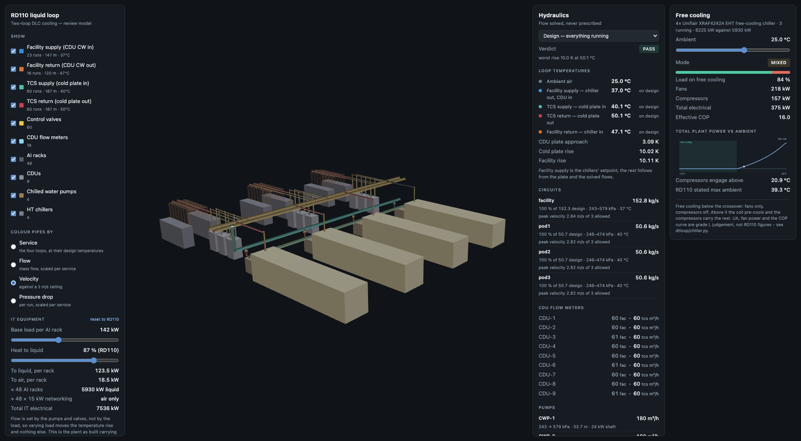

# Solve for the flow, don't prescribe it

SD-DC had its first commit on 8 September: a toolkit for data centre design led by
AI agents. The bet is in the README's first diagram: a brief goes in, an
agent calls tools for sizing, routing, costing, CFD and CAD, a model of the
building comes out, and every answer is checked by running it. If a check
fails, the agent goes round again. That's the design loop.

Most of that loop isn't built. Cable sizing to AS/NZS 3008 is mature. The
other tools exist as code but aren't services an agent can call yet, and
costing and layout aren't written. This post covers the first ten days:
a liquid-cooling model, a viewer for it, and some plumbing that makes the
loop more than a sketch.

## Flow is an output

The air-side CFD in the repo puts a fixed mass flow on its fan walls.
That's right for a steady design-point study. It's no use for asking what
happens when a valve shuts, because a prescribed flow can't redistribute.

So the liquid model
([`hydraulics.py`](https://github.com/sinkers/sd-dc/blob/e30c13299f903d0d249215cafc3a64ad401e8911/liquid-twin/loop/dtloop/hydraulics.py))
solves for every flow. Pipes are Darcy–Weisbach, valves get their resistance
from a characteristic at a given lift, pumps have a head curve, and every
node balances. Newton solves branch flows and node pressures together.

The test that proves it shuts one of four identical rack branches and tells
nothing else to change:

```python
net.branch("rack1").valves()[0].position = 0.0
shut = solve(net, base.as_array(net))
assert shut.converged

# The survivors gain - the whole point. Nothing told them to.
assert shut.flow("rack2") > base_each

# Total falls, but by less than the quarter that was removed, because the
# pump rides up its curve as the system resistance rises.
lost = 1.0 - shut.flow("pump") / base.flow("pump")
assert 0.0 < lost < 0.25
```
([test_hydraulics.py L129–151](https://github.com/sinkers/sd-dc/blob/e30c13299f903d0d249215cafc3a64ad401e8911/liquid-twin/loop/tests/test_hydraulics.py#L129-L151))

Total flow falls 23.7 %, not 25 %, and each of the other three racks gains
1.6 %. Nobody wrote that behaviour in. It comes from solving the network.

Three things only showed up when tests failed. A shut valve has to be a large
finite resistance, because infinite makes the Jacobian singular. A quadratic
pump curve through three ordinary datasheet points peaks half a metre above
shutoff, and that half-metre put the solver into a two-point limit cycle, so
the curve is now clipped monotonic. And a step clamp caused the cycle, so the
step is now globalised by backtracking.

## Numbers nobody chose

Every parameter sits in `loop_params.json` with its source and a confidence
grade. [`params.py`](https://github.com/sinkers/sd-dc/blob/e30c13299f903d0d249215cafc3a64ad401e8911/liquid-twin/loop/dtloop/params.py)
raises `PendingReference` rather than fill in a default. A default would
be a number nobody chose, and downstream you can't tell it from one somebody
did. At the start 24 values were null, including every temperature.

## RD110, and its chillers

Schneider's RD110 rev 3, a 10 MW reference design for GB300 racks, settled
the temperatures: facility water 37/47 °C, cold plates 40/50 °C. Six nulls
closed and the tests written to fail on its arrival did fail.

The surprise was that RD110 doesn't use dry coolers, which is what I was
modelling for. It uses four Uniflair XRAF4242A free-cooling chillers, N+1.
I first wrote that up as an argument against dry coolers. A commit later I
had it the wrong way round. Below some ambient those chillers *are* dry
coolers, fans only. Above it the compressors make up what the coil can't
take. [`chiller.py`](https://github.com/sinkers/sd-dc/blob/e30c13299f903d0d249215cafc3a64ad401e8911/liquid-twin/loop/dtloop/chiller.py#L121-L127)
works out the crossover rather than assuming it:

```python
def crossover_ambient_c(self, load_kw: float, return_water_c: float) -> float:
    return return_water_c - load_kw / self.ua_free_kw_per_k
```

At RD110's liquid load of 5,930 kW that's 21.3 °C. A fully loaded plant
loses free cooling at a lower ambient than a half-loaded one. Plant power
goes from 218 kW at 10 °C to 1,375 kW at 42 °C, a factor of 6.3. The coil
size, fan power and COP curve behind those numbers are my judgement, not
RD110's, and the code says so.

## What showing the flow caught

The plant is laid out in one file, `layout.py`, with no FreeCAD or numpy
in it. The FreeCAD STEP export, the browser viewer and the solver all read
it, so the pipes you see are the pipes the solver puts flow through:
4 chillers, 9 CDUs, 48 racks, 148 runs over 598 m.



*The loop viewer, pipes coloured by velocity. Every number in the side panels comes from the solved network.*

Once flows were on screen, three of my mistakes showed:

1. **8.5 m/s in the facility mains.** RD110's only pipe size callout is
   DN150 and I'd used it for the mains as well as the branches. Sizing on
   velocity gives DN300, and the facility pump went from 42.9 m and 30 kW
   to 23.0 m and 16.8 kW, a 44 % cut.
2. **A tripped CDU ran backwards.** With its pump off and no non-return
   valve, the solver drove −62 m³/h through the dead plate. Correct for the
   network as drawn, nonsense as a plant. `CheckValve` exists because of it.
3. **Losing a pump appeared to increase flow.** I'd reported circuit flow
   as one pump's flow times the count. With one pump off the survivors ride
   up their curves, and it read 193 kg/s against a 152 kg/s design.

In the next commit I fixed my own heat exchanger maths too. I'd calibrated the CDU
plate on the 3 K terminal approach, where effectiveness-NTU wants the
13 K inlet-to-inlet difference. That asked for an effectiveness of 3.33.
[`hx.py`](https://github.com/sinkers/sd-dc/blob/e30c13299f903d0d249215cafc3a64ad401e8911/liquid-twin/loop/dtloop/hx.py)
now raises on anything outside 0 to 1, which is how it surfaced.

The viewer is static: HTML, one JS module, a 0.6 MB geometry bundle and a
manifest of solved hydraulics. No service to run.

## The rest of the loop

On the cable side, trefoil formation was already in the engine but no caller
could reach it. Every request fell back to a guess and warned about it.
It's now a stated input on both sizing tools, and the response says which
formation it used. The MCP server only spoke stdio, which a hosted client
can't start, so
[`http_mcp_server.py`](https://github.com/sinkers/sd-dc/blob/e30c13299f903d0d249215cafc3a64ad401e8911/cable-sizing/http_mcp_server.py)
serves the same handler over HTTP. There's one implementation of the answer,
so the two can't disagree.

Finally, the README now names [IndustroML](https://github.com/sinkers/industroml)
as the model in the middle of the loop: containers, assets, interfaces and
connections in one schema. A connection that carries a route through named
trays is an electrical fact, a geometric fact and a line on a bill of
materials at once, which is what lets one tool hand a length to the next.

## What doesn't work yet

The liquid model is Phase 1 of 6: hydraulics, no thermal transport, so a
starved rack reports "starved" rather than a temperature. Every run in the
layout is straight or one right angle, so fitting losses are a floor. The
[pipe router](https://sinkers.github.io/devlog/2026/10/13/pipe-router/)
came later for that. The suite at the end of the period was 137 liquid-twin
tests, all green. The code is MIT on [GitHub](https://github.com/sinkers/sd-dc).
