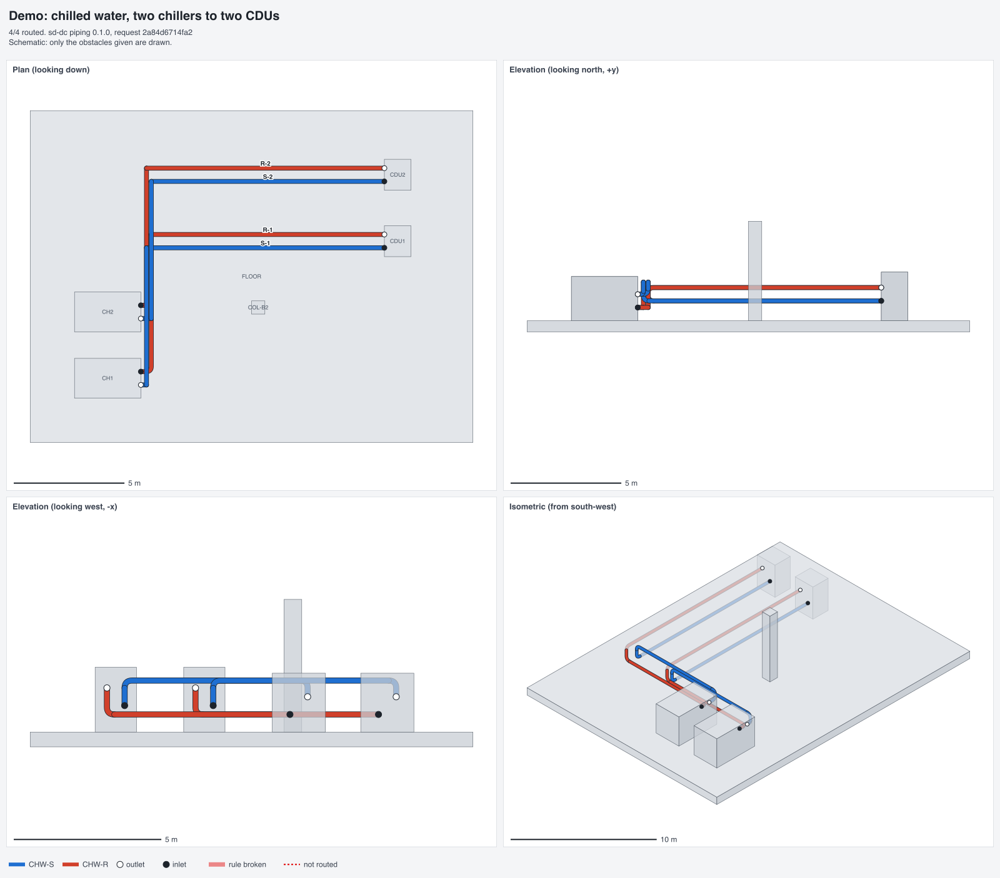
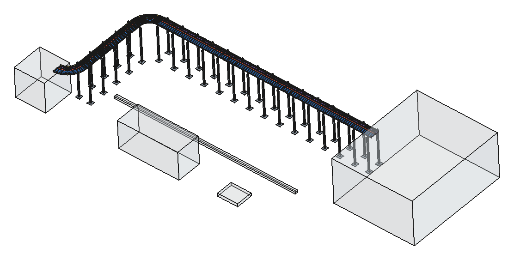

# A pipe router that says why it can't

[SD-DC](https://sinkers.github.io/sd-dc/) is a toolkit for designing data
centres with AI agents doing the legwork: cable sizing to AS/NZS 3008,
tray routing, parametric FreeCAD geometry, hall thermals. This week it
gained a pipe router, a cable tray router built on top of it, and a page
that explains the whole thing.

## The old router broke the rules it was meant to follow

There were already three routers in the repo. All of them searched a grid,
cell by cell, and then patched the result to look like pipework. That is
the wrong way round. A pipe isn't a path through cells. It's a set of
straight runs joined by elbows, and an elbow needs room. Searching cells
produced routes that turned straight out of a nozzle, put two elbows too
close together to fabricate, doubled back on themselves, or nudged an
endpoint a few millimetres to make the maths work.

The new one, [`piping/core/router.py`](https://github.com/sinkers/sd-dc/blob/173efe52a9a39b91503bd633db22560b35057d65/piping/core/router.py),
searches over **corners** instead of cells. A state is a corner plus the
direction the pipe was travelling when it got there. A move is a whole
straight run to the next corner. Because of that, the rules aren't checks
bolted on at the end. They're part of what a move is:

- the first run leaves the outlet along its outward direction, and the last
  run arrives head-on into the inlet. Endpoints are never snapped
- a run next to a nozzle is at least one bend radius long, and a run
  between two elbows at least two
- every turn is 90°, never 180°
- no run comes within pipe radius plus clearance of an obstacle

Here is the second rule in code. `need` is the shortest run that leaves
room for the elbows at both ends, and any corner closer than that is never
offered as a stop:

```python
reach, _ = fld.reach(p, d, first=is_start)
need = br if is_start else 2 * br
if reach + EPS < need:
    continue
line = coords[ax]
if s > 0:
    stops = line[bisect.bisect_left(line, p[ax] + need - EPS):
                 bisect.bisect_right(line, p[ax] + reach + EPS)]
```
([router.py L209–217](https://github.com/sinkers/sd-dc/blob/173efe52a9a39b91503bd633db22560b35057d65/piping/core/router.py#L209-L217))

Cost is length plus a fixed cost per elbow, so given two routes the router
picks the one with fewer elbows unless the other is a lot shorter. That's
also how a pipefitter would choose.

## Tested against a real design

The benchmark is a real chilled-water layout: 34 pipes, each routed by hand
by an engineer. The router finds all 34, one at a time and as a single
batch. None of its routes is longer than the hand route or has more
elbows, and the total comes to 194.2 m against 196.4 m. That benchmark
includes only the obstacles the build script places. The chillers, fan
walls and building shell come next, and they will make it harder.

The design data itself stays out of the public repo. The engines, schemas
and tests are open, and project data is gitignored. That split runs
through all of SD-DC.

## A failed route is an answer too

The part I care about most is what happens when there is no route. An agent
asked to route a pipe that can't be built needs to know *why*, so it can
move something and try again. The router doesn't return `None`. It returns
one of `blocked_nozzle`, `enclosed_inlet`, `enclosed_outlet`, `no_path`
or `no_path_within_budget`, along with the obstacle in the way, how short
the gap is, and a suggested fix
([`_blocked`](https://github.com/sinkers/sd-dc/blob/173efe52a9a39b91503bd633db22560b35057d65/piping/core/router.py#L249-L262)). Two scenarios from
the old routing report that looked like bugs turned out to be impossible
routes. They're now encoded as tests that expect a refusal.

## Served the way the cable sizer is

[`piping/service.py`](https://github.com/sinkers/sd-dc/blob/173efe52a9a39b91503bd633db22560b35057d65/piping/service.py) puts the router behind MCP
(stdio and HTTP) and REST, the same way the cable-sizing engine is served:
`piping_route_pipe`, `piping_route_network`, `piping_validate_route`,
`piping_list_specs`. A routed pipe comes back with its straights and
elbows, a bill of materials, the validator's verdict, and an IndustroML
connection that validates against the v1 schema. A second tool,
`piping_render_routes`, draws review sheets (plan, two elevations and an
isometric) with rule breaks in red and unrouted pipes dashed. Those
sheets are for a person to look over before anything is ordered.



*A review sheet from `piping_render_routes`: four chilled-water pipes, two chillers to two CDUs. The scene is invented.*

## Trays reuse the same router

Cable trays are routed by the same engine. The difference is that a flat
tray gets its real clearance above and below, not half its width, because
obstacles are now grown by the body's envelope in each run direction.
[`trays/tray.py`](https://github.com/sinkers/sd-dc/blob/173efe52a9a39b91503bd633db22560b35057d65/trays/tray.py) then supports the tray off the ground:
span from the load table, supports near fittings, splices landing beside
supports, cantilever or goalpost by width and load, and posts slid along
the run when they clash.



*The tray, its supports and every cable core, built in FreeCAD from the router's output.*

[`trays/cables.py`](https://github.com/sinkers/sd-dc/blob/173efe52a9a39b91503bd633db22560b35057d65/trays/cables.py#L170) sizes every circuit on the
tray with the AS/NZS 3008 engine, grouping all the runs together, and feeds
the cable mass back into the support span. Then
[`trays/freecad_build.py`](https://github.com/sinkers/sd-dc/blob/173efe52a9a39b91503bd633db22560b35057d65/trays/freecad_build.py) builds the tray,
supports and every core as a FreeCAD model and exports STEP. Cable
schedule out as CSV.

## What's next

The obstacles the benchmark doesn't have yet (chillers, fan walls, the
building) and a CAD host so other agents can ask for geometry rather than
just centrelines. The code is MIT on
[GitHub](https://github.com/sinkers/sd-dc), with 39 routing tests run by
`run-tests.sh`.
