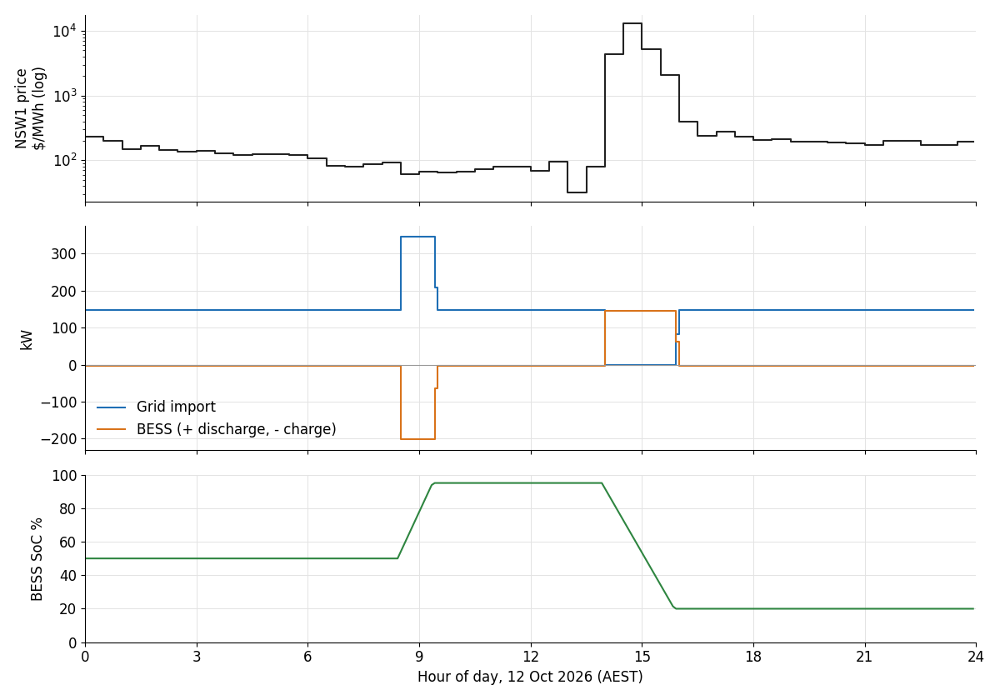
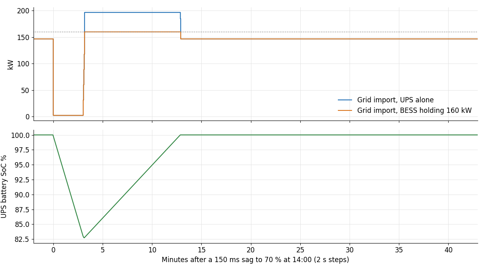
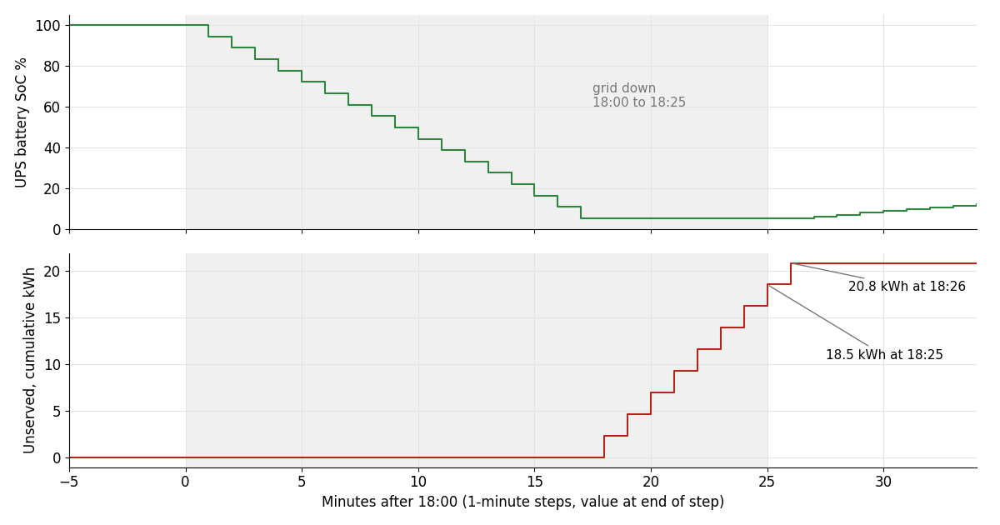

# Grid, BESS and UPS as drop-in components

[SD-DC](https://sinkers.github.io/sd-dc/) has a power simulator for a
site's grid connection. On AEMO prices for NSW1 on 12 October 2026, a
200 kW / 400 kWh BESS beside the UPS of a 139 kW GPU load saves $1,724.
On a flat $100/MWh day the same BESS loses $8. A 25-minute outage with no
generator leaves 20.8 kWh unserved.

It is one commit,
[`c367ee7`](https://github.com/sinkers/sd-dc/commit/c367ee7ac319de892a91fe2e51f26c0998a14a8f),
on the `power-sim` branch, not merged to main. Standard-library Python.

## How it works

Each component in `power-sim/model/dtpower/components/` declares an
IndustroML asset kind, its ports, a parameter schema and a role (`source`,
`bus`, `conversion`, `storage`, `load`, `controller`, `generator`). A
registry maps kind to class
([components/\_\_init\_\_.py L31](https://github.com/sinkers/sd-dc/blob/c367ee7ac319de892a91fe2e51f26c0998a14a8f/power-sim/model/dtpower/components/__init__.py#L31)).
A simulation is a list of assets and the links between them. This is all
of simulation 01's wiring:

```python
LINKS = [
    ("C-01", "cable", "UTIL.OUT", "MSB.IN"),
    ("C-02", "cable", "MSB.OUT", "BESS-1.AC"),
    ("C-03", "cable", "MSB.OUT", "UPS-1.IN"),
    ("C-04", "cable", "UPS-1.OUT", "GPU-1.IN"),
    ("D-01", "data_link", "DR-1.NET", "BESS-1.CTRL"),
    ("C-05", "cable", "GEN-1.OUT", "MSB.ALT"),
]
```
([sims/bess_dr.py L46–53](https://github.com/sinkers/sd-dc/blob/c367ee7ac319de892a91fe2e51f26c0998a14a8f/power-sim/model/dtpower/sims/bess_dr.py#L46-L53);
the diagram at the top is drawn from it with the component defaults.)

[`network.py`](https://github.com/sinkers/sd-dc/blob/c367ee7ac319de892a91fe2e51f26c0998a14a8f/power-sim/model/dtpower/network.py#L135-L182)
builds a tree from the links and steps it in a fixed order:

1. Loads report demand.
2. The UPS turns output demand into input demand: load, losses, recharge.
3. At each bus the passive feeders are summed, then the BESS controller
   decides, so it knows what the site draws.
4. Storage dispatches before the generator. Stored energy costs wear; a
   running set costs fuel.
5. The grid takes the remainder.

## What I checked it against

I exported the commit to a clean directory, ran the tests (146 passed) and
ran all 19 scenarios at their defaults:

```bash
python3 -m pytest -q tests
python3 -m dtpower run bess-dr --scenario nsw-spike
python3 -m dtpower run bess-dr --scenario nsw-spike --set BESS-1.capacity_kwh=800
```

The control is the flat-price day: with no spread, a positive saving would
be a bug. It comes out at −$8, the BESS's 2.4 kW of auxiliaries and
no-load loss.

| Scenario (defaults) | Price | Saving |
|---|---|---|
| NSW1, 12 Oct 2026, spike to $13,017/MWh | AEMO, recorded | $1,724 |
| Same, BESS doubled to 800 kWh | AEMO, recorded | $1,772 |
| Same, GPUs capped to 70 % above $300/MWh | AEMO, recorded | $1,763 (cap $39, 3.1 server-hours lost) |
| Same, generator above $500/MWh, no BESS | AEMO, recorded | $1,567 after $172 of fuel |
| NSW1, 10 Oct 2026, perfect-foresight controller | AEMO, recorded | $310 |
| Time-of-use, $380/MWh 15:00–21:00 | synthetic | $78 |
| NSW1, 9 Oct 2026, two peaks | AEMO, recorded | $30 |
| SA1, 8 Oct 2026, negative afternoon | AEMO, recorded | $15 |
| Flat $100/MWh | synthetic | −$8 |

The saving is not the bill difference. Each day runs four times, adding
the BESS, the GPU cap and the generator in turn. The saving is the
baseline bill minus the bill, minus battery wear, plus the change in
stored energy valued at the day's median price
([`_saving`](https://github.com/sinkers/sd-dc/blob/c367ee7ac319de892a91fe2e51f26c0998a14a8f/power-sim/model/dtpower/sims/bess_dr.py#L293-L294)).
On the spike day the bill falls by $1,748, wear is $7, and ending at 20 %
SoC against a 50 % start costs $17. Without that term a strategy looks
better by finishing emptier.



*`nsw-spike` at defaults, five-minute steps on 30-minute prices. Plotted
from the rows of `simulate("nsw-spike")` at c367ee7.*

The BESS charges 185 kWh and discharges 292 kWh, carrying the whole UPS
input through the spike.

## Sags and outages

Seven scenarios run 45 minutes at two-second steps. A sag is an event with
a depth and a duration, so a 150 ms dip inside a step still counts as
150 ms.



*`sag-no-ride-through` and `sag-bess-shave` at c367ee7. Dotted line:
the 160 kW site limit.*

| Scenario | UPS on battery | UPS min SoC | Peak grid import |
|---|---|---|---|
| Sag, no ride-through, 3 min resync | 190 s | 83 % | 197 kW |
| Same, ride-through on | 0 s | 100 % | 147 kW |
| Same, UPS max demand 160 kW | 190 s | 83 % | 162 kW |
| Same, BESS peak-shaving to 160 kW | 190 s | 83 % | 160 kW |
| Four sags in 6.5 minutes | 580 s | 46.5 % | 197 kW |

The 197 kW is the UPS recharging at 20 % of 250 kW on top of the load.
With a 200 kW generator in place of the grid, a 35 % recharge takes the UPS input to 232 kW and trips the set on its
110 % overload; holding the UPS to 185 kW keeps it on.



*`outage` at c367ee7, one-minute steps, plotted at the end of each step.
Shaded: grid down. The UPS carries 138.9 kW for 17 minutes, to its 5 %
floor.*

## What was wrong

**The README's outage figure.** It says 18.5 kWh unserved; the run says
20.83. Both are 138.9 kW times whole minutes: 18.52 kWh is eight minutes,
the energy lost while the grid was down. The ninth minute is 18:25, after
the grid is back. The UPS starts its 10 s walk-in with the rectifier
taking none of the load
([ups.py L161](https://github.com/sinkers/sd-dc/blob/c367ee7ac319de892a91fe2e51f26c0998a14a8f/power-sim/model/dtpower/components/ups.py#L161)),
the battery is empty, so the whole one-minute step is dropped. Setting
`UPS-1.walk_in_s=0` gives 18.52. The code's 20.8 is what the model
computes; I think 18.5 is closer to what the plant would do, and I'd fix
the walk-in rather than the README. No test pins either number.

**The mean charge price.** The summary's $67/MWh averages every step the
BESS reports `charging`, including four hours at 95 % drawing only
auxiliaries. Weighted by energy it is $63/MWh.

## Limits and what isn't done

- **Nothing is verified.** UPS losses, GPU idle power, throughput under a
  cap, $25/MWh battery wear, diesel burn and the AS/NZS 4777.2 reconnect
  defaults are all `verified: false`.
- **Energy only.** No demand charges, reactive power or cable losses; kW
  at unity power factor.
- **Radial networks only.** One source, no dual-path feeds.
- **No IndustroML `bess` kind.** IndustroML has no `bess`, `battery` or
  `inverter`, so these models don't validate against the schema yet.
- **Price timing.** Whether AEMO labels an interval by its start or its
  end isn't confirmed, so a price could sit one interval early.

The obvious objection: $1,724 comes from one half-hour at $13,017/MWh.
It does. The ordinary NSW day earns $30, and doubling the battery on the
spike day adds $48. Whether a BESS pays depends on spike frequency over a
year, which isn't modelled.

Not done: simulation 02, a UPS with a bidirectional rectifier so one
battery does ride-through and arbitrage. The code is MIT on
[GitHub](https://github.com/sinkers/sd-dc).
