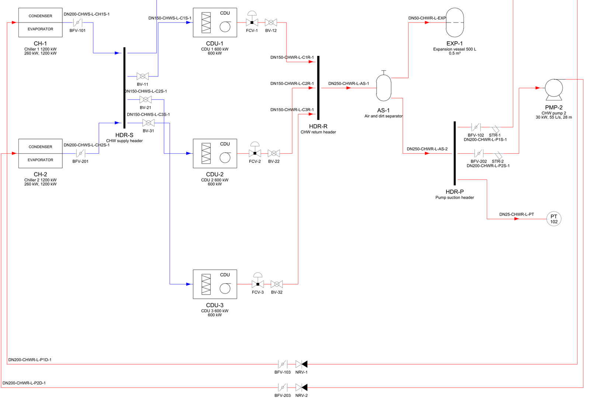
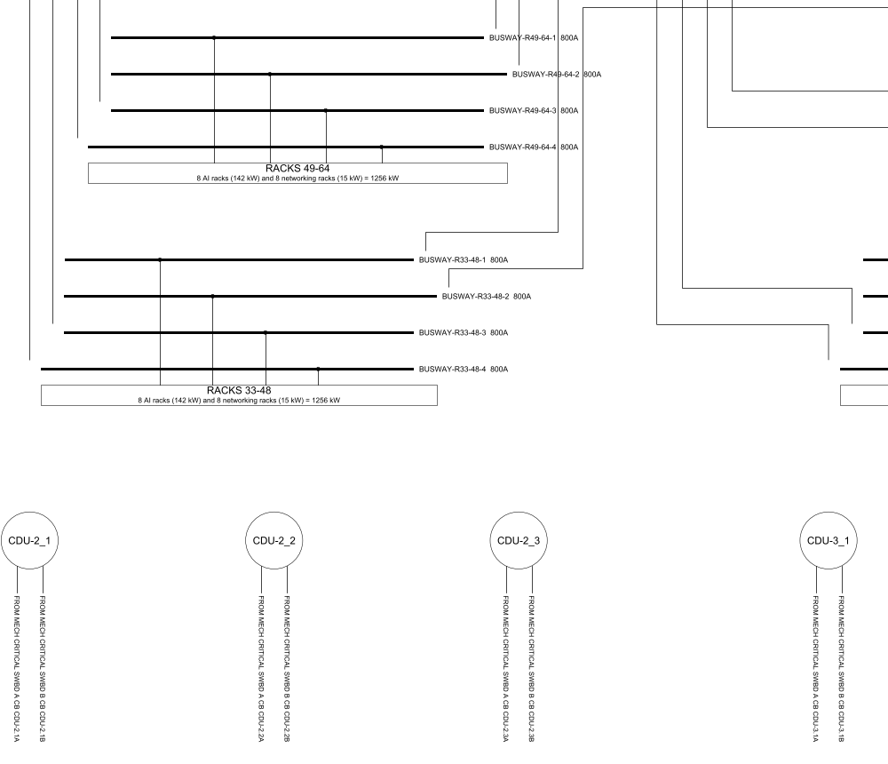

# SLDs and P&IDs generated from an IndustroML model

[`drawings/`](https://github.com/sinkers/industroml/blob/89a43a15d51eb07d19728263969c05c1bfe09d1d/drawings/README.md)
turns an [IndustroML](https://sinkers.github.io/industroml/) model into an
electrical single line diagram (SLD) and a P&ID, as DXF for CAD, PDF to
issue and PNG to review. Before this the repo only drew Mermaid graphs.
The same code redraws Schneider Electric's public RD110 one-line from a model
read out of its DXF: 296 nodes on an A0 and an A2 sheet.

## What is on a sheet

| Part | Where it comes from |
|---|---|
| Sheet | ISO 5457, smallest of A3 to A0 that fits at full size, zoned border |
| Title block, revisions | `meta.drawing`, `meta.revisions`; missing fields left blank |
| Legend | Only the symbols that sheet uses |
| Last note | Model file and the first 12 hex digits of the model's SHA-256 (full hash in the DXF header) |
| DXF | AutoCAD 2013 (AC1027), mm, full size; symbols are blocks with `TAG`, `RATING`, `VOLTS` attributes; colour, linetype and lineweight per layer |
| `--flat` | Explodes the blocks; FreeCAD's importer drops block attributes |

## How the SLD and P&ID are drawn

SLD symbols follow IEC 60617 (AS/NZS 1102). Feeder devices come from the
port's attributes; each cable carries id, construction, length and
method; cables over 1 kV are red, on `E-HV`.


*The A side of `dc_hall_demo_sld.png`, generated with `python3 -m drawings examples/models/dc_hall_demo.yaml` at 89a43a1. The data hall is invented (`examples/tools/make_dc_demo.py`). Title block and legend cropped out.*

The P&ID (ISO 10628-2, ISA-5.1 bubbles) lays equipment out in flow order,
valves inline in model order, a layer and colour per service.



*Part of `dc_hall_demo_pid.png` from the same run (A1, 14 nodes). Line numbers are `DN-service-id`.*

A drawing too big for one readable sheet is split:

| Drawing | Rule |
|---|---|
| SLD | Split when one sheet would need A0. Each *final board* (all circuits end at loads) gets a sheet, fed by off-sheet connectors such as "FROM MSB-A F-MECH, SHEET 1". The rest goes on an overall sheet. |
| SLD | If that overall sheet would print below 0.6 scale, each main board gets its own sheet too. |
| P&ID | Independent loops are drawn in separate bands; with `--sheet`, each gets a sheet if the combined one would print below 0.6 scale. |
| Both | `--sheet A3` issues every sheet at A3, scaled to fit. |

## Placed models

Automatic layout works for tens of items. Reading a reference-design
P&ID (about 950 pipes, 350 valves and 330 tees, per commit
[0b18647](https://github.com/sinkers/industroml/commit/0b1864726c9273cfff78ce2d75f872b22a74fcf6)) into a
model and drawing it back produced spaghetti. So the schema gained
optional positions; a P&ID whose assets are all placed is drawn there:

```yaml
assets:
- id: NRV-1
  kind: valve
  attributes: {valve_type: check}
  schematic: {at: [12.0, 40.0], rotation: 0}
connections:
- id: L-101
  type: pipe
  from: PMP-1.DISCHARGE
  to: NRV-1.IN
  attributes: {service: CHWS}
  schematic: {path: [[13.5, 40.0], [12.0, 40.0]]}
```

The same read-back added `tee` and `flexible_connection` as asset kinds
and a `role` on interfaces (supply, return, suction, discharge and so
on). A pipe with `dn_mm` is labelled `DN<size>` on its longest run,
[only if that run is long enough for the text](https://github.com/sinkers/industroml/blob/89a43a15d51eb07d19728263969c05c1bfe09d1d/drawings/pid.py#L651-L658).

## RD110 read back in

[`importers/rd110`](https://github.com/sinkers/industroml/blob/89a43a15d51eb07d19728263969c05c1bfe09d1d/importers/rd110/README.md)
reads `RD110_2.2_Elec_Oneline_EN_R0.dxf`, Schneider's 10 MW GB300
reference one-line, into a placed model. The DXF isn't in the repo (it
is on se.com). Counted from the committed models:

| Per variant (Paris, Singapore) | Count |
|---|---|
| Breakers (48 ACB, 120 MCCB) | 168 |
| Switchboards | 12 |
| Transformers / generators / HV supplies | 6 / 6 / 6 |
| UPS (12 Galaxy VXL, 2 Galaxy VL) | 14 |
| Busways, to 6 rack groups | 24 |
| Cables, each with a sheet path | 362 |

Breakers are the only blocks in that DXF. Boards are recognised as thick
polylines, transformers as two overlapping circles, UPS as dashed
enclosures. RD110 breaks a cable where it crosses another and
splits a busway either side of its notes, so the importer joins two ends
only where they face each other along one line, and treats an end landing
on the crossed cable as a crossing, not a tee.



*Part of `rd110_elec_paris_sld_01.png` (IT room, A0, 201 nodes), from `python3 -m drawings examples/models/rd110_elec_paris.yaml --sld` at 89a43a1. The mechanical sheet is A2, 95 nodes. Title block cropped out.*

It found one fault in the source: IT CRITICAL SWBD C has two breakers
labelled `AIIT-3.2C` and none labelled `AIIT-3.1C`. Both are kept, and the
second is `CB-AIIT-3_2C-DUP2` with a `check` attribute, not renamed.

## What I checked it against

- `pytest tests`: 76 tests, 73 pass and 3 skip in 6.2 s. Two skips are the
  full RD110 reads (the third is a JSON model), which need the DXF on disk (`RD110_SLD_DXF`); I didn't
  have it for this run, so the counts above come from the committed models,
  not a fresh import.
- Both example models regenerated at 89a43a1 with no warnings: demo SLD
  A0 and P&ID A1; RD110 Paris on A0 and A2.
- The editor's 49 Jest tests, measured at 2 s in commit 2602e32. Not re-run
  here: `node_modules` isn't installed.

## What was wrong

- The validator's duplicate-id check ran on dicts keyed by id, which keep
  only the last repeat, so it never fired. It now reads the lists:

```python
for key, kind in (("containers", "container"), ("assets", "asset"),
                  ("interfaces", "interface"), ("connections", "connection")):
    seen: Set[str] = set()
    for x in model.get(key, []) or []:
        xid = x.get("id")
        if xid in seen:
            errs.append(f"Duplicate {kind} id: {xid}")
        seen.add(xid)
```
([validate_industroML.py L107–116](https://github.com/sinkers/industroml/blob/89a43a15d51eb07d19728263969c05c1bfe09d1d/validate_industroML.py#L107-L116)).
Each validator check now has a test that breaks a model that way.

- The Jest suite took seven minutes or never returned: the repo sat in
  iCloud Drive under a path with spaces. Moving it fixed that.
- My first real project model (four main boards, dual-fed cooling boards,
  two chilled-water loops) was unreadable on one sheet. That is why the
  splitting exists.

## Limits

- Cable text is placed without collision checks, and on a crowded P&ID a
  line number can still touch a line.
- No port positions on equipment and no protection settings in the model,
  so neither is drawn. Control loops stop at the bubble; no signal lines.
- The obvious objection: a drafter in CAD lays it out better. Yes. But
  this drawing is regenerated from the model and carries its hash, so it
  can't drift from it, and a placed model keeps a drafter's layout.
- The [repo](https://github.com/sinkers/industroml) is public but has no
  LICENSE file, so it is readable but not yet licensed for reuse.
