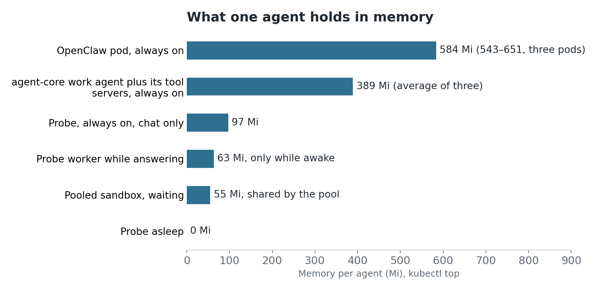

# Agents that use no RAM while they wait

An always-on AI agent is mostly a process waiting for a message. I assume about 99% of its time goes that way. On our dev cluster, three OpenClaw pods were holding 543–651 Mi each while using 1–4 millicores of CPU. So I tried a different shape: an agent that isn't running until there's work.

## A front door and a worker

[agent-core](https://github.com/sinkers/agent-core) is the agent engine I've been building. Its first public release, [0.1.0](https://github.com/sinkers/agent-core/releases/tag/v0.1.0), came out on 10 November and includes this trial. In the wake-on-demand trial a small [front door](https://github.com/sinkers/agent-core/blob/4883dcada7074e6daf93ff5aa9c6d440e91fd4e0/src/agentcore/frontdoor/core.py#L126-L135) stays on. It takes every message, call and scheduled task, [queues it in Postgres](https://github.com/sinkers/agent-core/blob/4883dcada7074e6daf93ff5aa9c6d440e91fd4e0/src/agentcore/frontdoor/db.py#L158-L172) and answers straight away with a holding line such as "just a moment, I'm waking up". It then starts a [worker](https://github.com/sinkers/agent-core/blob/4883dcada7074e6daf93ff5aa9c6d440e91fd4e0/src/agentcore/worker.py#L101-L119) for that agent in an [NVIDIA OpenShell](https://github.com/NVIDIA/OpenShell) sandbox. The worker answers, waits ten minutes for follow-ups, then exits. Nothing of the agent stays in memory except database rows.

A fresh sandbox takes about ten seconds, so I added a [warm pool](https://github.com/sinkers/agent-core/blob/4883dcada7074e6daf93ff5aa9c6d440e91fd4e0/src/agentcore/frontdoor/config.py#L24-L35): ready sandboxes with no agent, each handed to one agent when work arrives and thrown away when it's done. The test agent, Probe, has one waiting ([trial config](https://github.com/sinkers/agent-core/blob/4883dcada7074e6daf93ff5aa9c6d440e91fd4e0/deploy/scale-to-zero-poc/frontdoor/frontdoor.yaml#L49-L64)):

```yaml
pools:
  bedrock-workapi:
    size: 1
    only_for: [probe]    # this pool holds Probe's memory token
agents:
  probe:
    pool: bedrock-workapi
    max_workers: 2
    idle_seconds: 600
```

## Start-up

From the front door's event log, 3–4 November, across its API, Telegram and voice calls:

| | Median | Range | Runs |
|---|---|---|---|
| Holding line | 12 ms | | 67 |
| First answer from sleep, warm pool | 3.0 s | 2.0–6.2 s | 8 |
| First answer from sleep, fresh sandbox | 12.0 s | 9.5–15.2 s | 8 |

About two seconds of each answer is the model. The wake itself cost 0.4–0.9 s from the pool and 8.9–12.5 s from a fresh sandbox. Telegram adds about a second of its own before the holding line shows. I left out runs during deliberate failure tests and a four-minute outage I caused with a bad network policy. A burst bigger than the pool falls back to fresh sandboxes, so it's slower but still works.

## Memory



*Measured with kubectl top on 4–5 November, except the 63 Mi worker, measured on 3 November.*

This isn't like for like. Probe is a chat agent with scheduling and history tools, and OpenClaw does far more. Those OpenClaw pods also carry our own voice bridge. A real work agent in a worker would use more than 63 Mi, and one of ours sits at 485 Mi.

The shared parts don't go away either. The wake machinery (front door, OpenShell, sandbox controller and one pooled sandbox) holds 448 Mi. Postgres and the memory service are needed either way. The whole three-node trial cluster uses about 7 GiB, roughly what twelve of those OpenClaw pods use. For one or two agents on a small box, always-on is simpler and just as cheap. This pays off with many agents.

## What the RAM costs

RAM is getting dearer. TrendForce forecast conventional DRAM contract prices up [58–63% in Q2](https://iconnect007.com/article/149414/ai-server-demand-to-drive-memory-contract-price-increases-in-2q26-as-csps-secure-supply-via-longterm-agreements/149411/ein), server DRAM up [13–18% in Q3](https://www.trendforce.com/presscenter/news/20260709-13140.html) and conventional DRAM up [10–15% in Q4](https://www.trendforce.com/presscenter/news/20260930-13258.html). Those series differ, but together they would roughly double prices between the first quarter and year-end. CFM lists a [64 GB DDR5 RDIMM at US$1,630](https://www.chinaflashmarket.com/pricecenter/chart/ems/100263), up from $1,350 in May.

For a cloud price I used an on-demand [r7g.large](https://aws.amazon.com/ec2/pricing/on-demand/) in us-east-1: $0.1071 an hour for 16 GiB, or $4.89 per GiB-month with its CPU thrown in. [Fargate](https://aws.amazon.com/fargate/pricing/) charges $3.24 per GB-month for memory, plus CPU. Idle agents run out of RAM first, so I priced by RAM:

| Agents | Always on, 584 Mi | Wake on demand, 1% awake | Wake on demand, 10% awake |
|---|---|---|---|
| 1 | $2.79 | $2.14 | $2.17 |
| 100 | $279 | $2.44 | $5.14 |
| 10,000 | $27,900 | $32 | $303 |

*US$ per month. Wake on demand is 448 Mi plus 63 Mi per awake worker.*

The 99% idle figure is my assumption, not a measurement. The 10% column allows for each worker's ten minutes of waiting after a conversation. In a hard 26-hour test Probe's workers were up 21% of the time, so a busy agent could go past that column. With 485 Mi workers, 10,000 agents at 10% awake come to about $2,300 a month, still twelve times less. Always-on at 10,000 agents means 5.6 TiB of RAM, about 90 of those modules, or $147,000 in memory alone.

For one agent the saving is nothing worth having. The model bill is likely to be far bigger, and it doesn't change. This matters for a platform, not a personal assistant.

## OpenClaw and Hermes

This is about the always-on shape, not the projects. [OpenClaw's Linux docs](https://docs.openclaw.ai/platforms/linux) describe the gateway as a supervised service for always-on hosts, which suits something that holds channels open. [Hermes Agent's README](https://github.com/NousResearch/hermes-agent) already says that with Daytona or Modal its environment "hibernates when idle and wakes on demand, costing nearly nothing between sessions", and that it runs on a $5 VPS. I haven't measured Hermes, and I found no official memory requirement.

## What's not proven

- **Scale.** This ran one agent on three VMs on one host. The 100 and 10,000 rows are arithmetic, and the shared services will grow in ways I haven't measured.
- **Calls.** A voice call keeps a worker up until five minutes after the last turn, so calls aren't free of RAM.
- **New failure modes.** A model connection that sat idle went stale and one answer took 605 s, until the worker learned to [reconnect after 45 s idle](https://github.com/sinkers/agent-core/blob/4883dcada7074e6daf93ff5aa9c6d440e91fd4e0/src/agentcore/bedrock.py#L38-L40). When I powered off a node mid-task, the work finished on another node, 85–138 s later.

The next test is many agents waking at once, which is where these sums get checked.
