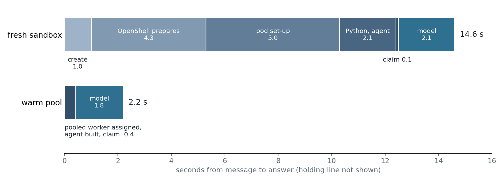

# Agents that use no RAM while they wait

In a one-agent trial of [agent-core](https://github.com/sinkers/agent-core) 0.1.0, a sleeping agent held 0 Mi of memory. The three always-on OpenClaw pods on the same test cluster held 543–651 Mi each while waiting for messages. The cost is start-up: the first answer from sleep took a median 3.0 s with one warm sandbox waiting, and 10.7–14.7 s without one. An agent spends most of its life waiting, so memory held while waiting is most of what it costs to host.

## How it works

A small [front door](https://github.com/sinkers/agent-core/blob/4883dcada7074e6daf93ff5aa9c6d440e91fd4e0/src/agentcore/frontdoor/core.py#L126-L135) stays up. It takes every message, call and scheduled task, writes it to a queue in Postgres and sends a holding line ("Just a moment, I'm waking up.") straight away. Then it starts a [worker](https://github.com/sinkers/agent-core/blob/4883dcada7074e6daf93ff5aa9c6d440e91fd4e0/src/agentcore/worker.py#L101-L119) for that agent in an [NVIDIA OpenShell](https://github.com/NVIDIA/OpenShell) sandbox. The worker [claims](https://github.com/sinkers/agent-core/blob/4883dcada7074e6daf93ff5aa9c6d440e91fd4e0/src/agentcore/frontdoor/db.py#L158-L172) the oldest item with `FOR UPDATE SKIP LOCKED`, one turn at a time per conversation, answers, waits `idle_seconds` for follow-ups, then exits. Between conversations the agent is only rows in Postgres.

A fresh sandbox takes about 10 s to start, so I added a [warm pool](https://github.com/sinkers/agent-core/blob/4883dcada7074e6daf93ff5aa9c6d440e91fd4e0/src/agentcore/frontdoor/config.py#L24-L35): workers started ahead of time with no agent, which wait at the front door. When work arrives, a pooled worker is given the agent, serves it for the rest of its life and is then thrown away, and the pool starts a replacement. A sandbox's policy and credentials are fixed when it is created, so a pool belongs to one profile. Probe's pool carries Probe's memory token, so it is locked to Probe ([trial config](https://github.com/sinkers/agent-core/blob/4883dcada7074e6daf93ff5aa9c6d440e91fd4e0/deploy/scale-to-zero-poc/frontdoor/frontdoor.yaml#L49-L64)):

```yaml
pools:
  bedrock-workapi:
    size: 1
    only_for: [probe]    # this pool holds Probe's memory token
agents:
  probe:
    pool: bedrock-workapi
    max_workers: 2
    idle_seconds: 600
```



*One recorded run of each path, from the timing tables in the plan at agent-core 4883dca. The fresh-sandbox steps add to 14.6 s; the recorded answer was 14.7 s.*

Nearly all of the cold path is the sandbox: 10.3 s before Python starts. The pool removes that and leaves the model turn.

## What I checked it against

The trial ran Probe, a chat agent with scheduling and history tools, on a three-node k3s cluster in VMs, through an API client, Telegram and voice calls. [`poc_tests.py`](https://github.com/sinkers/agent-core/blob/4883dcada7074e6daf93ff5aa9c6d440e91fd4e0/deploy/scale-to-zero-poc/poc_tests.py) runs the success criteria; the results are recorded in the [plan](https://github.com/sinkers/agent-core/blob/4883dcada7074e6daf93ff5aa9c6d440e91fd4e0/docs/plans/scale-to-zero.md).

| Check | Result |
|---|---|
| Memory while asleep | 0 Mi: no worker and no sandbox pods 10 min after the last message |
| Holding line | 10–16 ms to queue and answer |
| First answer from sleep, warm pool | median 3.0 s over the 3–4 November event log; 2.2 s in the `poc_tests.py` run |
| First answer from sleep, fresh sandbox | 10.7–14.7 s |
| Follow-up while awake | 1.8–2.0 s |
| 20 schedules due at once | all done in 34 s, never more than Probe's cap of 2 workers |
| Kill switch | worker cut off and its token revoked 1.2 s after the flip |
| Node powered off mid-task | work finished on another node 85 s and 138 s after power-off |


*Measured with kubectl top on 4–5 November, except the 63 Mi worker, measured on 3 November.*

This is not like for like. OpenClaw does far more than Probe, and our OpenClaw pods also carry a voice bridge. The repo's plan records slightly different figures from earlier runs: 78 Mi for an always-on Probe and 51 Mi for a waiting pooled worker, against 97 Mi and 55 Mi in the chart.

## What it costs

I priced RAM only, at $4.89 per GiB-month: an on-demand [r7g.large](https://aws.amazon.com/ec2/pricing/on-demand/) in us-east-1, CPU included. Wake on demand is the 448 Mi of always-on wake machinery (front door, OpenShell, sandbox controller and one pooled sandbox) plus 63 Mi per awake worker.

| Agents | Always on, 584 Mi | Wake on demand, 1% awake | Wake on demand, 10% awake |
|---|---|---|---|
| 1 | $2.79 | $2.14 | $2.17 |
| 100 | $279 | $2.44 | $5.14 |
| 10,000 | $27,900 | $32 | $303 |

*US$ per month. The 100 and 10,000 rows are arithmetic, not measurements.*

The awake fractions are my assumption. The 10% column allows for each worker's 600 s of waiting after a conversation. A work agent with tool servers needs more than 63 Mi: at 389 Mi per awake worker, 10,000 agents at 10% awake come to about $1,860 a month, 15 times less than always-on. At one agent the saving is under a dollar a month and the model bill dominates. This pays off on a platform with many agents, not for a personal assistant.

## What went wrong

- **Power-off, first run.** The Agent Sandbox controller ran as one replica on the node I switched off, so no sandbox could start for 5 minutes, and the front door counted the gateway's timeouts as failed starts and dead-lettered the work. The controller now runs as two replicas, and launcher errors back off and keep the work queued.
- **Leader election.** A Postgres advisory lock held by a replica on a dead node stays held until TCP gives up. It is now a 15 s lease renewed every 3 s.
- **Kill switch.** It first took 32 s, because the ticker waited for sandbox pods to go. Workers are now ended first.
- **Stale model connections.** An idle connection through the sandbox's egress proxy could die silently and the next call waited out the read timeout. The Bedrock client now [reconnects after 45 s idle](https://github.com/sinkers/agent-core/blob/4883dcada7074e6daf93ff5aa9c6d440e91fd4e0/src/agentcore/bedrock.py#L38-L40).

## Limits and what's not done

- **Scale.** One agent, at most 3 sandboxes at once. Sandbox start time with hundreds of workers is not measured.
- **Shared services.** Postgres and the memory service are needed either way, and their growth with agent count is not measured. For one or two agents on a small box, always-on is simpler and costs about the same.
- **Bursts.** More agents waking at once than the pool holds fall back to fresh sandboxes at 10.7–14.7 s.
- **Calls.** A voice call keeps its worker up for 300 s after the last thing said, so calls are not free of RAM.
- **The obvious objection:** Hermes Agent already does this. Its [README](https://github.com/NousResearch/hermes-agent) says that with Daytona or Modal its environment "hibernates when idle and wakes on demand". I haven't measured Hermes. agent-core's version keeps the channels on the front door, so the agent shows online and answers with a holding line while asleep.

The next test is many agents waking at once.
