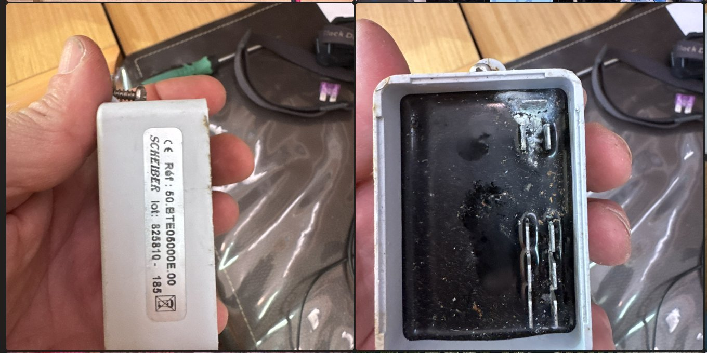
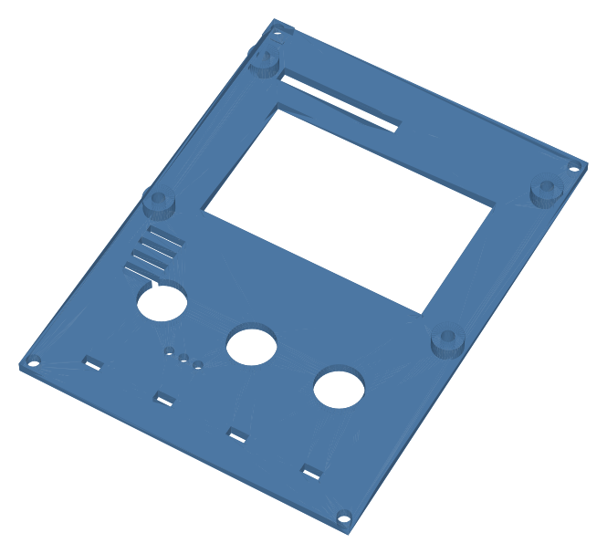
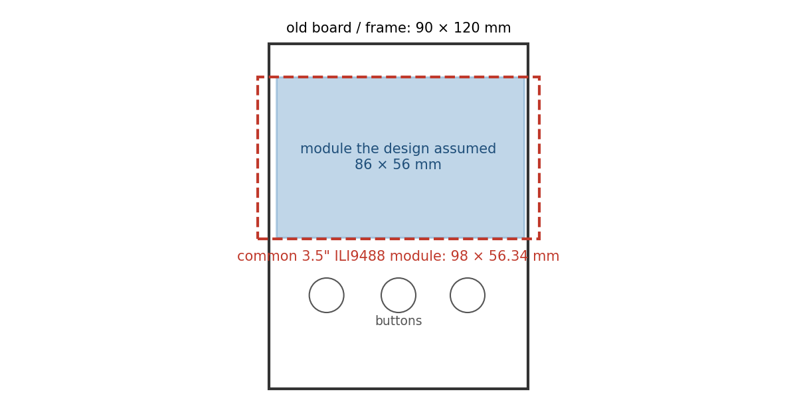

# Measure twice, cut the harness once

The batteries-and-tanks panel at the nav station of my Beneteau First 45 is
dead. It's a Siemens VDO "Batteries & Levels" LCD on a 90 × 120 mm board,
held in a fixed frame by four corner screws, fed by two plugs: a 3-way for
power and a 12-way for everything it measured. The plan is to put an
ESP32-S3 and a 3.5" colour screen in the same frame.

Three weeks in, nothing is built. What I have is a harness I now
understand and a design that changed shape because of it. This post is about that order of work: verify every pin
before anything gets cut.

## The first readings were wrong in an instructive way

On the first visit I took a printed worksheet to the boat and measured all
twelve pins of the big plug with the panel unplugged: resistance to battery
negative, then volts. The sheet is the right half of the image above.

The readings looked sensible. Two pins read 36 Ω each and one read 28 Ω,
which is what resistive tank senders look like, so I concluded that all
three tanks used the same Euro 10–180 Ω senders and the firmware defaults
could stand.

That same day I found the factory manual. The water channels aren't
resistive at all. Each water tank has a transmitter box that turns a
five-rod probe into a 0–6 V signal, and the panel itself powers those boxes
through one of the 12 pins. With the panel unplugged, the boxes were
unpowered, so the 36 Ω I had measured was the resistance of a dead output.
Only the fuel reading meant anything.

The manual corrected two other things. The current shunt is 100 A / 50 mV
(0.5 mΩ) on the high side, not the 500 A part I had assumed. And the
manual numbers the pins differently from my worksheet, which counted
positions looking into the plug. Every pin map in the repo now says which
numbering it uses.

## The transmitter wasn't the one in the manual

The manual lists a VDO transmitter. Pulling one out showed a Scheiber
50.BTE05000E.00 instead, fully resin-potted with corroded FASTON tabs. The
current drop-in is the 50.BTE110009.00. Its datasheet gives the output
steps, which became the calibration table: empty 1.0–1.2 V, ¼ 2.1–2.3 V,
½ 3.2–3.4 V, ¾ 4.35–4.55 V, full 5.5–5.7 V.



*The water-level transmitter as found: label, opened case, and a manufacturing label on its loom.*

## Measuring again, powered

On the second visit, with the system powered and the old panel's supply
pin feeding the boxes, the confirmed map came out like this
(positions looking into the harness plug, top left to right):

```
Pos  Found                       Reading
1    Stern water signal          2.3 V   -> 1/4 tank (band 2.1-2.3 V)
2    Fwd water signal            1.2 V   -> empty    (band 1.0-1.2 V)
3,4  Negative
5    Fuel sender (10-180 ohm)    85 ohm  -> about 45 %
6    Empty cavity
7    +12 V feed to both Scheiber boxes
8    Red, unknown
9    Negative
10   Red, old shunt sense
11   Empty cavity
12   Red, unknown
```

Both water readings sit right on the Scheiber steps, so both boxes are
alive. That cancelled a bench test and any replacement boxes. The fuel
reading didn't agree with the earlier 28 Ω at the sender, and that turned
out to be a real fault in the tank sender, since fixed. It now reads
fine.

The next day I measured the three reds to ground: 0 V on all of them,
against the same negatives the water pins read correctly from. The 1 A
fuse on the distribution card is fine, and the reds don't run straight to
the batteries. They're most likely orphaned taps left over from earlier
work, which would also explain why the old panel's battery readings died.
I decided not to trace them. They get abandoned in place, taped and
labelled, and treated as live when cut, because one could be on an
ignition-switched circuit.

## Rev C: the panel stops measuring things

Once I knew what each pin carried, the obvious question was why the
panel should measure any of it. The boat is getting a Victron system
anyway: a Cerbo GX, a Lynx Smart BMS for the lithium house bank, and an
Orion XS for the start battery. All of that talks NMEA 2000.

So in rev C the panel is a display client. The harness never reaches it.
The 12-way plug is cut, landed one-to-one on a terminal strip, and from
there the fuel sender goes to a Cerbo tank input and the two water signals
go to a Victron GX Tank 140, because the Cerbo's own tank inputs are
resistive only and can't read a 0–6 V box. The boxes stay on the boat's
12 V supply. The Tank 140 has sender-power terminals, but they put out
24 V, and the Scheiber boxes are rated 9–15 V.

The panel keeps the screen, three buttons, a buzzer, a CAN transceiver,
Wi-Fi, and its own supply and backlight sensing. It gains one sensor, a
BME280, for cabin temperature, humidity and a barometer it broadcasts back
onto the bus. The rev C board went from 143 footprints to 82.

The install guide for the cut is deliberately boring: label each wire,
photograph the plug, then cut one wire at a time.

## A printed chassis first

The custom board is placed but not routed, and it may never need to be.
The first build is a 3D-printed plate that drops into the frame on the
original corner screws, holding off-the-shelf modules. It's drawn in
OpenSCAD, along with a separate fit-check model for the display stack and
the space behind the frame. Neither has been printed or trial-fitted yet.



*The front plate, rendered from the repo's STL.*

## What is still waiting

The screens arrived on 8 November and are "quite large". The design
assumed an 86 mm wide module:

```
// ---- TFT module (KMRTM35018 / MSP3520 class) -- tune after measuring -
mod_x0 = 2.5;  mod_y0 = 11.5;          // module outline origin (board y, down)
mod_w  = 86;   mod_h  = 56;
```

The common 3.5" ILI9488 module of that class is 98 × 56.34 mm, wider than
the 90 mm board it replaces. I don't yet know if the frame's cavity has
room for the overhang, so the next step is calipers on the real module and
the frame, then either re-lay the plate or find a narrower panel. The
firmware doesn't care either way: same controller, same 480 × 320.



*The size problem. The 98 mm outline is centred for comparison; its real position depends on measurements I don't have yet.*

The two BME280 breakouts were lost in customs. A replacement is on its
way, and it defaults to I²C address 0x77 where the firmware assumed 0x76.
The buttons coming are square PCB tactiles, so the plate's round holes
need reworking.

The firmware is still the rev B code, which reads sensors and transmits
battery and tank data. The next big job is turning it round: receive
battery, tank and temperature messages from the Cerbo, mark anything older
than about 10 seconds as stale and show "--" instead of an old number, and
broadcast the BME280.

The repo is [on GitHub](https://github.com/sinkers/beneteau-f45-display)
under the Apache 2.0 licence. So far only the licence has been pushed.
