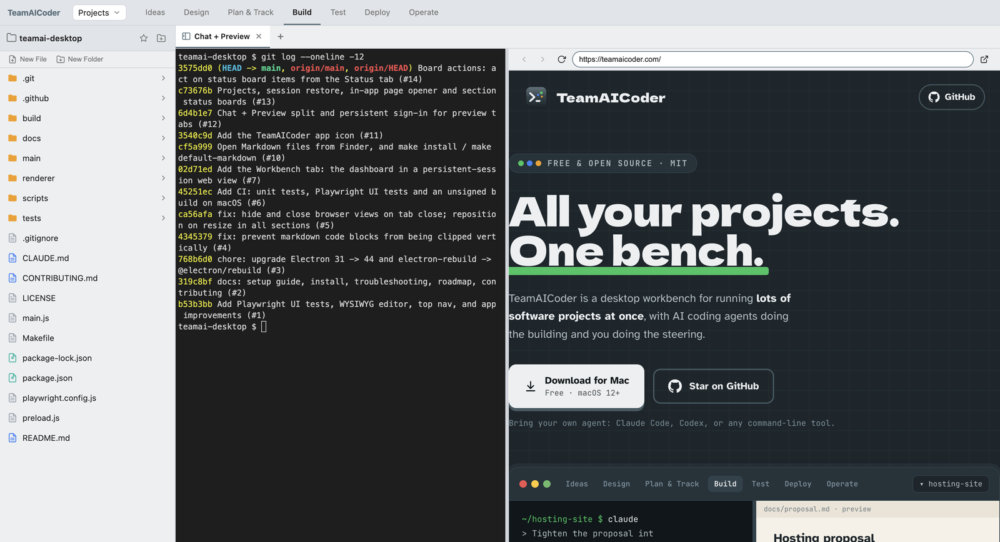

# TeamAICoder 0.1.0: one window for many projects and their agents

I run a lot of software projects at once, and most of the building is done
by AI coding agents in terminals. The hard part isn't the agents. It's
keeping track of which terminal belongs to which project, where the spec is,
and what's waiting on me.
[TeamAICoder](https://github.com/teamaicoder/teamai-desktop) is the
open-source workbench I'm building in public to do that. Today it builds as a
signed, notarised macOS app, version 0.1.0.

## What it is

One Electron window, organised by stage of a project's life: Ideas, Design,
Plan & Track, Build, Test, Deploy and Operate. Each section has its own
folder, file tree and tab strip. A tab is a file (Markdown or code), a real
terminal (node-pty and xterm.js), or a web page. Run `claude`, `codex` or
anything else in a terminal, and keep the spec and the GitHub board in the
next tab.

The work from the last two weeks, in the order it landed:

- **Electron 31 to 44** ([#3](https://github.com/teamaicoder/teamai-desktop/pull/3)).
  This wasn't optional. macOS started blocking Electron 31.7.7 as malware:
  `spctl` reported that its notarisation had been revoked. The binary
  matched the official SHA-256, so it was a revocation, not tampering. The
  upgrade also swapped the deprecated `electron-rebuild` for
  `@electron/rebuild`.
- **CI** ([#6](https://github.com/teamaicoder/teamai-desktop/pull/6)). The
  repo had none. Every PR now runs the Jest unit tests, the Playwright UI
  tests driving the real Electron app, and an unsigned build, on
  `macos-latest`.
- **A Workbench tab** ([#7](https://github.com/teamaicoder/teamai-desktop/pull/7))
  that embeds my project dashboard in its own persistent session, so I stay
  signed in across restarts. Links to other sites open in the system browser.
- **Open Markdown from Finder** ([#10](https://github.com/teamaicoder/teamai-desktop/pull/10)).
  The app declares a Markdown document type, so it can be the default app
  for `.md` files. One finding: the older `LSSetDefaultRoleHandlerForContentType`
  returns success but is ignored on current macOS, so `make default-markdown`
  uses `NSWorkspace.setDefaultApplication` instead.
- **Chat + Preview** ([#12](https://github.com/teamaicoder/teamai-desktop/pull/12)):
  a terminal on the left for the agent and a browser on the right, with a
  draggable divider. Every preview tab shares one persistent session, so a
  SharePoint or Google Docs sign-in happens once.
- **Projects, session restore and status boards**
  ([#13](https://github.com/teamaicoder/teamai-desktop/pull/13)). Projects
  are imported from a folder of Markdown files with YAML frontmatter, and
  each repo is matched to its local checkout by its `origin` remote. On
  relaunch every section's tabs come back. If exactly one terminal in a
  folder was running `claude`, the restored one runs `claude --continue`.
- **Board actions** ([#14](https://github.com/teamaicoder/teamai-desktop/pull/14)),
  covered below.



*A Chat + Preview tab in the Build section, captured from the app by a Playwright script. The left pane is a real shell in the repo.*

## Getting a browser sign-in to work inside the app

Embedding sign-in pages was the most fiddly part. Microsoft and Google
sign-in both stalled on the passkey prompt, because Electron has no passkey
UI. Preview pages now hide WebAuthn, so both fall back to a password and an
authenticator app. Google still refused embedded Chromium even with a plain
Chrome user agent, so on `accounts.google.com` only, the preview presents
itself as Firefox. That's a workaround, not a fix. If your organisation
requires phishing-resistant MFA, the toolbar has an "open in system browser"
button.

## Acting on a status board

A section can pin a status page as its first tab. It refreshes in the
background, at most every two minutes. Since #14, buttons on that page can
do things. A `teamaicoder://terminal?project=<slug>&prompt=<text>` link
opens a Chat + Preview tab in the project's folder and starts Claude Code on
the prompt. A `teamaicoder://action` link sends a JSON payload to a script
of mine on stdin, then refreshes the board.

Typing a page-supplied prompt into a shell is the risky bit, so the prompt
is cleaned and quoted as one argument before it gets near the terminal
([handlers.js](https://github.com/teamaicoder/teamai-desktop/blob/3575dd06af98a9ce2b020e599769566b400fac9f/main/handlers.js#L521-L533)):

```js
function cleanPrompt(text) {
  return String(text == null ? '' : text)
    .replace(/[\u0000-\u001f\u007f-\u009f]+/g, ' ')
    .trim()
    .slice(0, PROMPT_MAX_CHARS);
}

function claudeCommand(prompt) {
  const p = cleanPrompt(prompt);
  return p ? `claude ${shellQuote(p)}` : 'claude';
}
```

One unit test passes a quoted prompt to a real `/bin/sh` and checks it
arrives as one argument. The links only work in a Status tab: ordinary
browser tabs drop them, and the commands and project folders come from
preferences on disk, never from the page.

## Signed and notarised

The release work is in
[#15](https://github.com/teamaicoder/teamai-desktop/pull/15). The app now
runs under the hardened runtime, with
[entitlements](https://github.com/teamaicoder/teamai-desktop/blob/71d1dd30d87f4836b816d2d324a3957001c5c284/build/entitlements.mac.plist)
for Electron's JIT and node-pty's native module, and is notarised with an
App Store Connect API key. `npm run dist:release` builds a `.dmg` and a
`.zip` for both Apple silicon and Intel.

Pushing a `v*` tag runs
[release.yml](https://github.com/teamaicoder/teamai-desktop/blob/71d1dd30d87f4836b816d2d324a3957001c5c284/.github/workflows/release.yml).
It builds and notarises, checks each app with `codesign`, `spctl` and
`stapler`, runs the Playwright suite against the packaged Apple silicon app,
runs it again against the Intel app on a `macos-15-intel` runner, then
attaches everything to a draft release for me to publish. One workaround:
electron-builder 26.8 unlocks its own keychain with the wrong password, so
the workflow imports the certificate into a job keychain itself.

Locally, both apps were notarised and stapled, the app inside a quarantined
DMG was accepted by Gatekeeper, and 84 UI tests and 141 unit tests passed
against the notarised Apple silicon build. The Intel app hasn't been tested
yet. That happens on the workflow's first run.

## Being findable: sitekit

A desktop app nobody can find doesn't help anyone, so the same week I wrote
[sitekit](https://github.com/teamaicoder/sitekit), a small Python toolkit
(standard library, plus Pillow for share images). `sitekit build` fills in
what a static site lacks: `sitemap.xml`, a `robots.txt` that names and
allows search and AI crawlers, `llms.txt`, an IndexNow key and missing head
tags. It only adds, and never touches a file the site wrote itself.
`sitekit audit` checks the live site the way crawlers see it, including
whether a CDN challenges `OAI-SearchBot`, `Claude-SearchBot` or
`PerplexityBot`. `sitekit track` snapshots competitors' releases, posts,
taglines and pricing pages and reports what changed.

[teamaicoder.com](https://teamaicoder.com) is the first site using it: its
[sitekit.toml](https://github.com/teamaicoder/teamaicoder.com/blob/0fd86107ae1dae94661205d5b02e3bf7e2921b84/sitekit.toml)
lists seven tools to watch, from Conductor to Claude Squad. My honest
expectation for `llms.txt` is nothing: crawlers rarely fetch it. It's
generated because it costs nothing. Search indexing is what gets a page into
AI answers.

## What's next

0.1.0 is macOS only. Pages opened by tools that call macOS `open` directly,
rather than `$BROWSER`, still go to the external browser, and terminal
scrollback isn't restored. Next on the
[roadmap](https://github.com/teamaicoder/teamai-desktop/blob/3575dd06af98a9ce2b020e599769566b400fac9f/docs/roadmap.md)
are GitHub sign-in, and coding agents running on your own Kubernetes
cluster instead of your laptop. The code is MIT on
[GitHub](https://github.com/teamaicoder/teamai-desktop).
