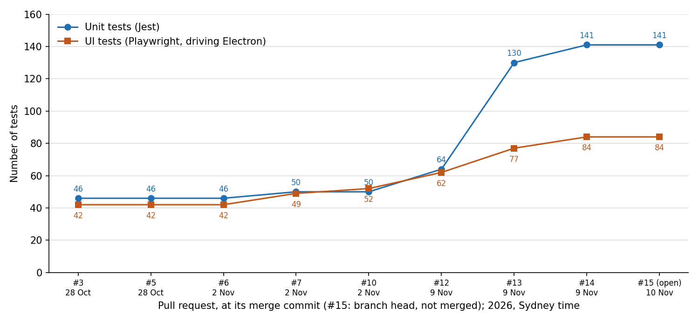

# TeamAICoder: 11 merged PRs and a notarised 0.1.0 build

[TeamAICoder](https://github.com/teamaicoder/teamai-desktop) is an
open-source Electron app for running many software projects with AI coding
agents in one window. Between 28 October and 9 November 2026 (Sydney time)
11 PRs were merged into it, and the unit tests went from 46 to 141. On
10 November I opened
[#15](https://github.com/teamaicoder/teamai-desktop/pull/15), which signs
and notarises a 0.1.0 build for macOS. As of 11 November #15 is open, not
merged, and there is no 0.1.0 release or tag on GitHub.

## What it is

One window, split by project stage: Ideas, Design, Plan & Track, Build,
Test, Deploy and Operate. Each section has its own folder, file tree and
tabs. A tab is a Markdown or code file, a terminal (node-pty and xterm.js),
a web page, or a Chat + Preview split: terminal on the left, browser on the
right.


*A Chat + Preview tab in Build, captured by a Playwright script from a
throwaway profile with a set prompt. Left: `git log` of the repo at
`3575dd0`. Right: teamaicoder.com.*

| PR | Merged | What changed |
|---|---|---|
| [#2](https://github.com/teamaicoder/teamai-desktop/pull/2) | 28 Oct | Setup, install, troubleshooting and roadmap docs |
| [#3](https://github.com/teamaicoder/teamai-desktop/pull/3) | 28 Oct | Electron 31 to 44; `electron-rebuild` to `@electron/rebuild` |
| [#4](https://github.com/teamaicoder/teamai-desktop/pull/4), [#5](https://github.com/teamaicoder/teamai-desktop/pull/5) | 28 Oct | Markdown code-block clipping; browser views not closed with their tab |
| [#6](https://github.com/teamaicoder/teamai-desktop/pull/6) | 2 Nov | CI on `macos-latest`: unit, UI, unsigned build. None before |
| [#7](https://github.com/teamaicoder/teamai-desktop/pull/7) | 2 Nov | Workbench tab: a configured URL in a `persist:workbench` session |
| [#10](https://github.com/teamaicoder/teamai-desktop/pull/10) | 2 Nov | Markdown document type, so Finder opens `.md` files in the app |
| [#11](https://github.com/teamaicoder/teamai-desktop/pull/11), [#12](https://github.com/teamaicoder/teamai-desktop/pull/12) | 9 Nov | App icon; Chat + Preview, one `persist:preview` session for all previews |
| [#13](https://github.com/teamaicoder/teamai-desktop/pull/13) | 9 Nov | Projects imported from Markdown files, session restore, status boards |
| [#14](https://github.com/teamaicoder/teamai-desktop/pull/14) | 9 Nov | Board actions from a Status tab |

#3 was forced. macOS blocked Electron 31.7.7 as malware: `spctl` said its
notarisation had been revoked. The binary matched the published SHA-256, so
it was a revocation, not tampering.

## How the board actions work

A section can pin a status page as its first tab, refreshed in the
background at most every 2 minutes. Since #14 two link forms on that page do
something. `teamaicoder://terminal?project=<slug>&prompt=<text>` opens a
Chat + Preview tab in the project's folder and types `claude '<prompt>'`.
`teamaicoder://action?payload=<JSON>` runs a configured command with the
payload on stdin (64 KB cap, 60 s timeout) and refreshes the board on
exit 0.

The prompt comes from a web page and is typed into a shell, so it is
cleaned and quoted as one argument
([handlers.js](https://github.com/teamaicoder/teamai-desktop/blob/3575dd06af98a9ce2b020e599769566b400fac9f/main/handlers.js#L521-L533)):

```js
function cleanPrompt(text) {
  return String(text == null ? '' : text)
    .replace(/[\u0000-\u001f\u007f-\u009f]+/g, ' ')
    .trim()
    .slice(0, PROMPT_MAX_CHARS);   // 4000
}

function claudeCommand(prompt) {
  const p = cleanPrompt(prompt);
  return p ? `claude ${shellQuote(p)}` : 'claude';
}
```

Main, not the renderer, decides which views are Status views. Other browser
tabs drop `teamaicoder://` links. The command and the project folders are
read from preferences on disk, never from the page.

## What I checked it against

I re-ran the tests at each merge commit: `jest --json` for the unit tests
and `playwright test --list` for the UI tests. All unit tests pass at every
commit.



*Test counts at each merge commit, and at #15's branch head `71d1dd3`.
Unit: Jest `numTotalTests`. UI: `playwright test --list`.*

Three PR descriptions disagree with the run. #6 says 36 unit tests; there
were 46. #13 says 125 unit and 76 UI; the merge commit has 130 and 77. #14
says 83 UI; it lists 84. The descriptions were written before the last
commits on each branch.

One unit test sends a prompt holding `'`, `$HOME`, backticks, `$(...)`
and `*` through a real `/bin/sh` and checks it arrives unchanged as one
argument. The UI test for #14 puts a stand-in `claude` on `PATH` and checks
a multi-line prompt end to end.

## Sign-in inside the app

Microsoft and Google sign-in stalled on the passkey prompt, because
Electron has no passkey UI. Preview pages now hide WebAuthn, so both fall
back to a password and an authenticator app. Google still refused embedded
Chromium with a plain Chrome user agent, so on `accounts.google.com` only
the preview presents as Firefox. That is a workaround. Where an organisation
requires phishing-resistant MFA, the toolbar's "open in system browser" is
the only route.

## Signing and notarisation (#15, open)

#15 turns on the hardened runtime with three
[entitlements](https://github.com/teamaicoder/teamai-desktop/blob/71d1dd30d87f4836b816d2d324a3957001c5c284/build/entitlements.mac.plist):
JIT and unsigned executable memory for V8, and disabled library validation
for node-pty's native module. Notarisation uses an App Store Connect API
key. `npm run dist:release` builds a `.dmg` and `.zip` for arm64 and x64.

A `v*` tag runs
[release.yml](https://github.com/teamaicoder/teamai-desktop/blob/71d1dd30d87f4836b816d2d324a3957001c5c284/.github/workflows/release.yml):

| Job | Runner | Does |
|---|---|---|
| `build-mac` | `macos-latest` | build, sign, notarise; `codesign`, `spctl`, `stapler`; UI suite on the packaged arm64 app |
| `test-intel` | `macos-15-intel` | `spctl`; UI suite on the packaged x64 app |
| `draft-release` | `ubuntu-latest` | attach both to a draft release |

electron-builder 26.8 unlocks its own keychain with the wrong password, so
the workflow imports the certificate into a job keychain itself.

Locally, both apps were notarised and stapled, the app in a quarantined DMG
passed Gatekeeper, and 84 UI and 141 unit tests passed against the
notarised arm64 build. The x64 app has not been run. The workflow is only on
the PR branch, so it has never run.

## sitekit

[sitekit](https://github.com/teamaicoder/sitekit) is a Python package
(standard library; Pillow optional for share images, 15 unit tests).
`sitekit build` adds what a static site lacks: `sitemap.xml`, a
`robots.txt` naming 16 search, AI and training crawlers, `llms.txt`, an
IndexNow key and missing head tags. It never overwrites a file the site
wrote. `sitekit track` watches competitors;
[teamaicoder.com's config](https://github.com/teamaicoder/teamaicoder.com/blob/0fd86107ae1dae94661205d5b02e3bf7e2921b84/sitekit.toml)
lists seven. I expect nothing from `llms.txt`, since crawlers rarely fetch
it.

`sitekit audit https://teamaicoder.com` on 11 November passed all nine
checks, including a 200 for `OAI-SearchBot`, `Claude-SearchBot` and
`PerplexityBot`. It also showed my mistake: the share image is `icon.png`.
The page already had an `og:image`, so sitekit left it alone and the
1200×630 `og.png` it made is unused.

## Limits

- No release yet. Until #15 merges and a tag is pushed, the site's
  "Download for Mac" button falls back to build-from-source.
- macOS only.
- Tools that call macOS `open` rather than `$BROWSER` still go to the
  external browser. Terminal scrollback isn't restored.
- The obvious objection: a web page that can start a shell command. The
  page chooses a project slug and prompt text only. The command is fixed,
  the prompt is one quoted argument, and only a Status tab acts on the link.
  A hostile board can still send Claude Code a hostile prompt, so point
  Status tabs only at pages you control.

Next on the
[roadmap](https://github.com/teamaicoder/teamai-desktop/blob/3575dd06af98a9ce2b020e599769566b400fac9f/docs/roadmap.md):
GitHub sign-in, and agents running on your own Kubernetes cluster. MIT
licence.
