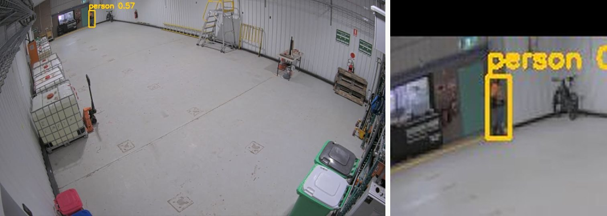

# Which vision model should check a camera alert? 21 models, 78 cases, $2.40

[cvkit](https://cvkit.net/) runs an object detector next to the cameras, on
a Raspberry Pi 5 with a Hailo-8L, and only sends a detection upstream when
something has moved. Before anyone is alerted, a vision model on the hub
looks at the detection and says whether it is real. This week I added a
benchmark that picks that model: 21 models, 78 labelled detections, $2.40 a
run, once a month. The results, the method and every image and answer are
public at
[cvkit.net/resources](https://cvkit.net/resources/reports/vision-benchmark/).

## What the model is asked

Each case is one detection: the frame the detector saved, with its box drawn
on, and the claim (label, score, box). The model gets what the live service
sends, a system prompt, one line of text and two images: the full frame and
a 448 px crop centred on the box, 2.5 times the box's larger side. It
returns JSON with `real`, `label`, `people`, `confidence` and a one-line
`description`.

The answer is scored against three hand-assigned fields: is the claim real,
which labels are acceptable for the main object in the box, and how many
people are in the frame. Quality is
`10 × (0.7 × verdict + 0.2 × label + 0.1 × people)`, with 0 for no valid
JSON. The verdict carries most of the weight because it decides whether
anyone is alerted.


*Case real-34: what the model sees. The person is about 15 px wide in the
frame. glm-5.3-flash called it "orange hi-vis clothing hanging by the green
door frame". Frame and crop are the case's own image and `vision.crop`
output.*

The 78 cases are 53 real and 25 false. The real ones are detector events
from a 30-minute shadow run: one worker walking, cycling and pushing a
pallet jack inside a shed, and trucks on the road outside. The false ones
are boxes drawn the way the detector draws them, on things that fool
detectors: ladders, extinguishers, bins, IBC tanks, a hi-vis vest on a hook.

## How the pick is made

Recall on real events is a hard requirement, because a missed intruder costs
more than an extra alert. The value pick is the cheapest model within 0.3
quality of the best, with recall of at least 95%, median latency of 8 s or
less and 98% valid answers
([run.py L157–167](https://github.com/cvkitio/edge/blob/6a9052474e6daeedc831d0ccc0563b15703bfa31/components/verify/evals/run.py#L157-L167)):

```python
best = rows[0]
ok = [r for r in rows if r["quality"] >= best["quality"] - tolerance and (r["recall"] or 0) >= min_recall
      and r["p50_s"] is not None and r["p50_s"] <= max_p50_s and r["valid"] >= 0.98]
value = min(ok, key=lambda r: r["cost"]) if ok else best
```

A CronJob on the hub runs it at 06:30 on the 1st of each month. It writes
the pick to a NATS key, and the verify service reloads it within a minute.
The run uses its own OpenRouter key with a $10 monthly limit, so a benchmark
can't eat the live service's budget.

## Results

| model | quality | recall | false rejected | $/1k checks | median s |
|---|---|---|---|---|---|
| gemini-3.5-flash-lite | 10.0 | 100% | 100% | 0.89 | 1.7 |
| gemini-3.8-flash | 10.0 | 100% | 100% | 2.90 | 5.1 |
| claude-sonnet-5.5 | 9.99 | 100% | 100% | 4.20 | 2.3 |
| claude-haiku-5.5 | 9.85 | 100% | 96% | 0.29 | 2.4 |
| **deepseek-v4.1-flash** | 9.83 | 100% | 96% | **0.10** | 2.8 |
| glm-5.3-flash | 9.73 | 96% | 100% | 0.10 | 4.7 |
| moondream3.1-9b-a2b | 5.35 | 81% | 0% | 2.80 | 1.2 |

*Second run, 26 November 2026, 1,638 calls. Cost is what OpenRouter charged.*

deepseek-v4.1-flash is the value pick. At 1,000 checks a day that is about
$0.10 a day. Its one wrong verdict was a shipping container on a trailer,
which it called a vehicle; 7 of the 21 models got that case wrong.
gemini-3.5-flash-lite got every case right for $0.89 per 1,000. That's nine
times the price, and still under a dollar a day at 1,000 checks. Six of the
21 models scored 9.85 or better.

## What went wrong

**The first run's pick didn't survive the second.** The morning run picked
glm-5.3-flash at 9.85 with 100% recall. In the evening run it scored 9.73
and called two real people at the far door hi-vis clothing (real-34 above,
and real-41). At 96% recall it still met the bar, but deepseek-v4.1-flash
had gone from 9.74 to 9.83, and its cost per check had halved from $0.19 to
$0.10 per 1,000. It came in $0.002 per 1,000 cheaper than glm-5.3-flash and
took the pick. Same cases, same prompt, temperature 0. With 53 real cases,
one miss is 1.9 points of recall. A single pass can't separate models that
are this close.

**The scores overwrote the answers.** The first run stored the score fields
`label` and `people` over the model's own `label` and `people`, so the
record showed whether each answer was right but not what it was. The fix
keeps them as `answer_*`
([run.py L113–114](https://github.com/cvkitio/edge/blob/6a9052474e6daeedc831d0ccc0563b15703bfa31/components/verify/evals/run.py#L113-L114)),
and a test covers it. The second run was needed partly to get the answers
for the public method page.

**One label of mine was wrong.** I marked a "car" box on an empty flatbed
trailer as a false alarm. 18 of the 21 models called it real. A trailer is a
vehicle, and nothing in the prompt says otherwise, so they were right.
It is labelled real now, which is why the first run has 52 real cases and
the second 53.

## Limits

- One site, five fixed fisheye cameras, daylight, mostly one person. No
  night, rain, glare, animals or crowds. The ranking is a first cut until
  the set covers more sites.
- The false cases are constructed, not detector mistakes caught live.
- One pass per model. The flip above says the monthly run should repeat
  each case at least three times before switching models. That isn't done
  yet.
- OpenRouter's `:batch` variants cost half as much but only work through
  its batch API, and the live check needs an answer in seconds.

The code is in
[components/verify](https://github.com/cvkitio/edge/tree/6a9052474e6daeedc831d0ccc0563b15703bfa31/components/verify)
on an open PR ([cvkitio/edge#4](https://github.com/cvkitio/edge/pull/4)),
not merged.
