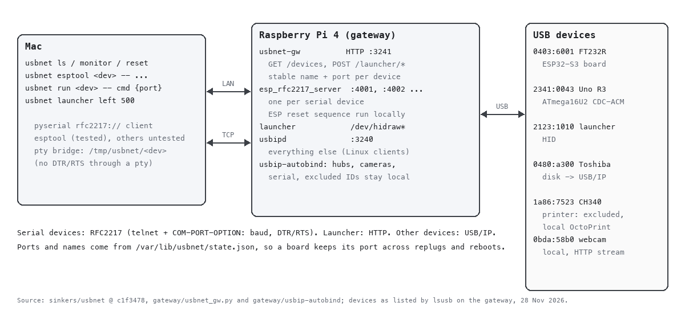

# usbnet: flashing an ESP32 on a Raspberry Pi from a Mac

[usbnet](https://github.com/sinkers/usbnet) puts USB devices plugged into a
Raspberry Pi within reach of my Mac. The first target was serial boards: an
ESP32-S3 on the Pi's hub shows up on the Mac as
`rfc2217://printpi.local:4001`, and `esptool` connects to it, identifies the
chip and runs its flasher stub across the LAN. It is about 980 lines of
Python and shell, MIT licensed, with 17 tests. Everything below was run on
28 November 2026 against a Pi 4 on wired Ethernet and a Mac on the same LAN.

## Why not USB/IP on the Mac

Linux has USB/IP: the Pi exports a device, a client attaches it, and it
appears as local USB. macOS has no USB/IP client. Making a remote device look
local needs a virtual USB host controller inside macOS. Kernel extensions
used to do that and are now deprecated. [VirtualHere's client logs "Unable to
connect to the kernel"](https://www.virtualhere.com/node/3471) when it
tries Apple's user-space API for this.
Parallels and UTM only go the other way: they take a device that is
physically on the Mac and hand its traffic to a VM.

So usbnet works per device class instead, and translates each class into
something macOS already understands. Serial goes over RFC2217, which is
telnet plus COM-PORT-OPTION, so the remote end can set baud and drive DTR and
RTS. pyserial speaks it, and so does anything built on pyserial, including
esptool. A Linux machine can still use USB/IP for everything else.



*The pieces as deployed. Devices are as listed by `lsusb` on the Pi; ports
and code from [`usbnet_gw.py` at c1f3478](https://github.com/sinkers/usbnet/blob/c1f3478330e076d5ac46273189226af55eab260c/gateway/usbnet_gw.py).*

## How it works

On the Pi, `usbnet-gw` polls `/sys/class/tty` every 2 s for `ttyUSB*` and
`ttyACM*`. It gives each device a name, made from the chip plus the USB
serial number (or the port path when the chip has no serial number), and a
TCP port from 4001 upwards. Both are kept in `/var/lib/usbnet/state.json`,
so a board gets the same port after a replug or a reboot. The daemon runs one
`esp_rfc2217_server` per device and lists them all on `GET :3241/devices`. A
udev hook shares any other device over USB/IP, except hubs, cameras, serial
devices and anything in `/etc/usbnet/exclude`. The 3D printer's CH340 is in
that list, because OctoPrint on the same Pi drives it.

On the Mac:

```bash
uv tool install --with esptool git+https://github.com/sinkers/usbnet
usbnet ls
usbnet esptool fuel -- chip-id          # --port filled in from the gateway
usbnet esptool fuel -- read-flash 0 0x40000 dump.bin
usbnet reset fuel                       # pulse EN to see the boot log
usbnet run arduino -- tool -p {port}   # local pty path
usbnet launcher left 500
```

## What I checked

| Test, macOS client | Result |
|---|---|
| `esptool chip-id` (esptool 5.7.0) | ESP32-S3 (QFN56) rev v0.2, MAC 28:84:85:90:04:e4, stub running |
| `read-flash` 256 KB at 115200 | 23.5 s, 89.4 kbit/s, digest OK |
| `read-flash` 256 KB at 460800 | 11.1 s, 188.7 kbit/s, digest OK, byte-identical to the 115200 read |
| `read-flash` at 921600 | 1 MB: "Digest mismatch". 256 KB: "Read more than expected" |
| pyserial read after `usbnet reset` | 482 bytes of boot log and firmware output |
| Uno R3, avrdude 6.3 signature read via pty | fails, see below |
| `arduino-cli monitor` via pty | fails: "error getting modem bits status" |

I didn't write firmware during these tests. The board belongs to another
project, and a read-back at a reliable baud rate exercises the same data path
as a write.

## What was wrong along the way

The first version served each port with ser2net. Reads worked, but esptool
failed every time with "Wrong boot mode detected (0x8)". Getting an ESP32
into its bootloader takes a DTR/RTS sequence timed to tens of milliseconds,
and a LAN round trip between each step throws the timing off. Espressif ships
`esp_rfc2217_server` for exactly this case. It spots the start of the reset
sequence and runs the whole thing on the Pi. With that server, esptool
connected on its first attempt. The cost is a Python process per device
instead of one ser2net.

Smaller mistakes:

- ser2net rejected the generated config when no devices were plugged in
  ("Unexpected scalar value"), because a YAML document with no entries is
  null.
- The names file cut "Fuel ESP32" down to "fuel".
- During an upgrade, the old daemon was still running. It saw its config
  disappear, rewrote it, and restarted ser2net, which then grabbed port 4001.
- `uv tool install` kept serving a cached 0.1.0 wheel until I bumped the
  version.

## Limits

The obvious objection is that RFC2217 isn't USB. It isn't, and that shows
up in the tools.

- **Uploading to AVR boards doesn't work yet.** My bridge reconnects to reset
  the Uno, and the bootloader does answer. But replies to avrdude's early sync
  bytes arrive after avrdude has already drained its input, so every later
  reply is one out of step ("expect=0x10, resp=0x04"). Faking replies on the
  Mac would be fragile. The fix is to run avrdude on the Pi, the way
  Espressif's server handles ESP resets there.
- **A pty can't carry modem lines.** `arduino-cli monitor` and the Arduino
  IDE's serial monitor give up on it. Tools that take a `rfc2217://` URL
  avoid the problem.
- **921600 baud is unreliable.** Use esptool's default of 460800.
- **No authentication.** Anyone who can reach ports 3241 or 4001 and up can
  reflash a board. Keep it on a trusted LAN or tailnet.
- **Untested:** PlatformIO, `idf.py`, screen or minicom on the pty, and
  ESP32-S3 boards on native USB, which re-enumerate during reset.
- Opening a session resets the board, as a local USB port usually does.

## Next

Storage: the Pi will mount a USB drive and share it over SMB, with a
`usbnet mount` command on the Mac. The same day, the Pi also took over
OctoPrint and the printer camera from the home server. A USB missile launcher
turned up on the hub as well. It is driven through `/dev/hidraw` from
`POST /launcher/<action>`, and it moves.
