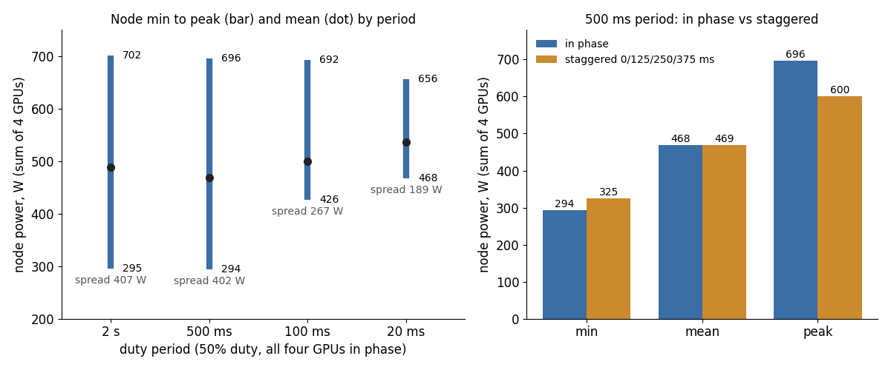

A GPU can swing from idle to its full power limit and back many times a
second, and grid operators care how large and fast those swings are across
a hall. [gpu-power-lab](https://github.com/sinkers/gpu-power-lab) measures
them with synthetic workloads; the first two rounds used one NVIDIA B300.

R3, the eight-GPU node round, did not run. The 8 x B300 VM I booked on Spheron
reported a healthy node to NVML, and every CUDA call returned 802, `system
not yet initialized`, because the host never activated the NVSwitch fabric.
The day before, a $2 rehearsal on 4 x A10G found five harness defects.

The R3 commits (`ed37f65` to `809be25`) are local and not on GitHub yet,
so they are named by short SHA. Links go to `249b1c9`, the last pushed
commit.

## The rehearsal

The whole R3 campaign ran on a `g5.12xlarge` spot instance: four A10Gs,
about an hour. An A10G is a 300 W Ampere part and the power virus targets
Blackwell, so it reaches about 175 W; the numbers test the harness, not the
silicon. Four of the five defects produced plausible output, not an error:

1. CMake missed NCCL on a Deep Learning AMI and the build still succeeded.
2. The collator summed the driver-averaged power field, which flattened
   every swing. Phase alignment for in-phase and staggered read 0.959 and
   0.938.
3. A deliberate stagger was reported as a barrier failure.
4. The fixed barrier lead time was 5 s short on a cold cache, so every
   device missed it.
5. Waiting at the barrier undid warmup. Devices idled back to 74 W and a
   no-duty rung showed 410 W of spread that was all ramp.

After the fixes the worst barrier alignment across ten rungs was 114 ms.



*Node power on 4 x A10G, sum of four NVML `POWER_INSTANT` readings in
20 ms bins, GPU draw only. From the `node-*.json` summaries in
`results/t3-rehearsal-4xa10g` at commit `ed37f65`.*

Offsetting the four GPUs by 0, 125, 250 and 375 ms kept mean power within
1 W and cut peak by 96 W and spread by 127 W.

In the duty sweep spread falls from 407 W at 2 s to 189 W at 20 ms, mostly
because the trough rises 173 W while the peak falls 45 W. The project's
notes blame the board or NVML. I think the 20 ms rung says nothing either
way: the sampler achieved 43 to 45 Hz of a requested 100, about one reading
per cycle. On the single B300 the instantaneous counter held a swing
of about 900 W from 5 ms to 2 s
([report](https://github.com/sinkers/gpu-power-lab/blob/249b1c9555b0db81754e2c1fef750ab91d0a5f8c/results/b300-consolidated/report.html)),
so the A10G drop is not a general property of the harness.

## The bootstrap

The B300 VM came with no driver, CUDA or NCCL, and installing them took
about 12 paid minutes. Meanwhile I wrote `scripts/r3-bootstrap.sh`
(`9357b17`). It syncs, builds the runner, and checks three things that had
failed before: NCCL found at
configure time, NVML power readable on every device, and a 10 s NCCL
allreduce across all GPUs. Any failure prints `BOOTSTRAP FAILED — do not
start the campaign` and exits non-zero.

The same commit put the NCCL collectives before the duty sweep, since
NCCL over NVSwitch only exists on this hardware; added repeats
(`GPL_R3_REPEATS`), because every figure so far is n=1; and added a 600 s
node soak, because on the single B300 a 12 s window read
[90.4% of the limit](https://github.com/sinkers/gpu-power-lab/blob/249b1c9555b0db81754e2c1fef750ab91d0a5f8c/results/t2-b300/README.md)
and a
[30-minute soak](https://github.com/sinkers/gpu-power-lab/blob/249b1c9555b0db81754e2c1fef750ab91d0a5f8c/results/t2-b300-batch2/rung-soak-30min.json)
read 94.4%.

## CUDA 802

With the driver in, `nvidia-smi` showed eight GPUs, 275,040 MiB each,
1100 W enforced limits, live power draw and NV18 all-to-all in
`nvidia-smi topo -m`. `cudaGetDeviceCount`, `cudaSetDevice(0)` and
`cudaFree(0)` all returned 802.

The GPUs carried Fabric GUIDs but sat at `Fabric State: In Progress`,
`CliqueId: N/A`, for over 20 minutes. `lspci` showed the eight GPUs and no
NVSwitches, and the guest has no `nvidia-nvswitch` module, so fabric
registration is the host's job. CUDA does not start until it is done. Ruled
out from inside the VM:

| Tried | Result |
|---|---|
| Fabric Manager 610.57.04 in the guest, exact driver match | `NV_WARN_NOTHING_TO_DO`: no switches to manage |
| Reload with `RmNvLinkDisable=1` | Still 802 |
| Device nodes, permissions, root, persistence mode | All fine |
| Clean reinstall of `nvidia-open` 610.57.04 | No change |

I sent Spheron a support note with the evidence and that list
(`5eb5cd8`). Their answer was that NVSwitch is only available on their
bare-metal nodes, and they have no B300 bare metal.

## What the bootstrap would have done

NVML was healthy, so the first two checks pass on this node. The only
thing that fails is the NCCL smoke test, and only through the absence of a
file:

```bash
timeout 240 sudo ./build/gpu-power-runner --device 0 --op nccl ... \
    --out-summary /tmp/bootstrap-smoke.json 2>&1 | grep -E "nccl:|ERROR|error"
...
[ -f /tmp/bootstrap-smoke.json ] || { say "  FAIL: NCCL smoke produced no summary"; fail=1; }
```

The runner calls `cudaSetDevice` in `main.c` before any workload, gets
802, prints `cudaSetDevice(0) failed` and exits 4 without writing a
summary. I ran the script's remote section with stubs for `nvidia-smi`,
`cmake` and the runner that reproduce this node:

| Case | Last lines | Exit |
|---|---|---|
| Fresh node | `FAIL: NCCL smoke produced no summary`, `BOOTSTRAP FAILED` | 1 |
| Summary left in `/tmp` by an earlier run | `cudaSetDevice(0) failed`, then `BOOTSTRAP OK` | 0 |

So it catches this node, imprecisely:

- It fails after the sync and full build. The test plan in `809be25` says
  it "fails on this in seconds"; that overstates it.
- The failure is reported as an NCCL problem. Nothing mentions the fabric.
- It tests that the file exists, not that this run wrote it, and the
  runner's exit code is lost in the pipe. A rerun in the same boot after a
  success passes.
- The `devices=$NGPU` check in the script is a no-op.

I have no saved bootstrap output from the B300 node itself.

## The test plan

The [test plan at `249b1c9`](https://github.com/sinkers/gpu-power-lab/blob/249b1c9555b0db81754e2c1fef750ab91d0a5f8c/TESTPLAN.md#L58-L71)
said a dedicated VM with full passthrough was good enough for single and
multi-GPU work. That was wrong for a switched node. In `809be25` it is
narrowed to single-device work, with bare metal as the default for a
switched node and this check before booking any VM:

```bash
nvidia-smi -q | grep -A2 "^    Fabric"
```

`State: Completed` with a real `CliqueId` means the fabric is up.
`In Progress` with `CliqueId: N/A` means CUDA will fail.

The obvious objection is that VMs can't do this. They can: a hypervisor
can activate the fabric for a guest, and AWS sells `p4d`, `p5` and `p6` as
NVLink instances that are Nitro guests. It depends on the provider.
Spheron's single-B300 VM ran the T2 ladder; their eight-GPU VM could not
run CUDA at all, and there is no degraded mode.

## Not done

- R3 is unmeasured. Nothing here is a B300 node result.
- The bootstrap does not read the fabric state. A fabric check before the
  build, a per-run summary path and checking the exit code are next; none
  is written.
- The R3 commits are not pushed.

---

*Originally published on [devlog](https://sinkers.github.io/devlog/2026/08/19/b300-fabric/). The code is on [GitHub](https://github.com/sinkers/gpu-power-lab).*
