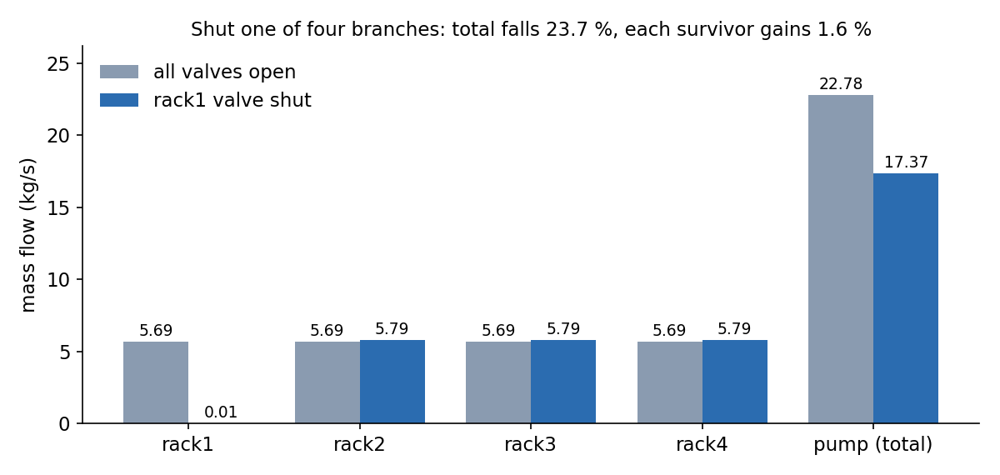
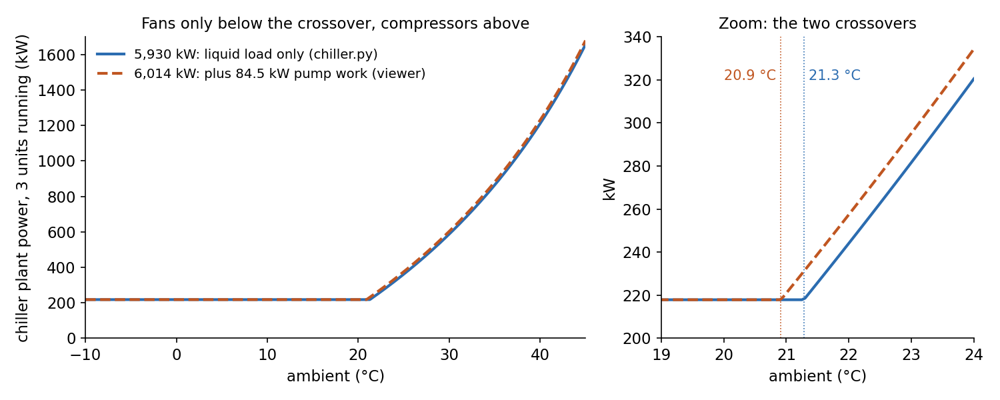
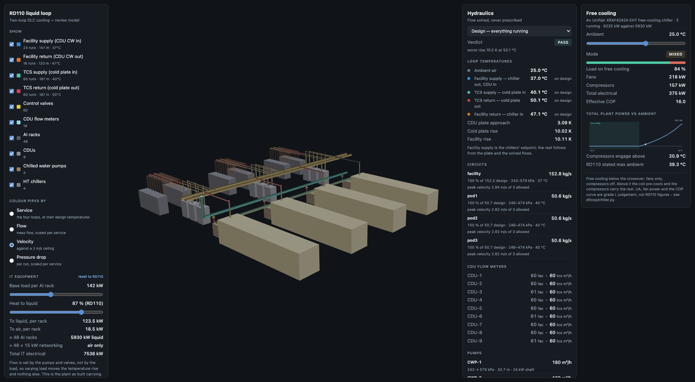

Racks for current AI hardware put most of their heat into water: a cold
plate on each chip, a coolant distribution unit (CDU) per group of racks,
and a facility loop out to the chillers. SD-DC is my open-source toolkit
for designing data centres with agents; this is its liquid-cooling model.

In its first ten days SD-DC got a hydraulic model of the liquid-cooling
plant in Schneider's RD110 reference design: 4 chillers, 4 pumps, 9 CDUs,
48 racks and 159 pipe runs over 641 m, with every flow solved rather than
typed in. Shut one rack valve in the test network and total flow falls
23.7 %, not 25 %. Putting the solved flows on screen found three mistakes
of mine. 137 tests pass at
[`e30c132`](https://github.com/sinkers/sd-dc/tree/e30c13299f903d0d249215cafc3a64ad401e8911/liquid-twin).

SD-DC is meant to become a design loop: an agent calls sizing, routing,
costing, CFD and CAD tools, and every answer is checked by running it.
Most of that isn't built yet.

## How it works

The air-side CFD in the repo fixes the fan-wall mass flow, which can't
redistribute when a valve shuts. [`hydraulics.py`](https://github.com/sinkers/sd-dc/blob/e30c13299f903d0d249215cafc3a64ad401e8911/liquid-twin/loop/dtloop/hydraulics.py)
treats flow as an output instead:

- pipes are Darcy–Weisbach with fitting K values;
- valves take their resistance from a characteristic at a given lift;
- pumps have a head curve;
- Newton solves branch flows and node pressures together, with mass
  balanced at every node.

The test that carries the idea shuts one of four identical rack branches
and changes nothing else:

```python
net.branch("rack1").valves()[0].position = 0.0
shut = solve(net, base.as_array(net))
assert shut.converged
assert shut.flow("rack2") > base_each
lost = 1.0 - shut.flow("pump") / base.flow("pump")
assert 0.0 < lost < 0.25
```
([test_hydraulics.py L129–151](https://github.com/sinkers/sd-dc/blob/e30c13299f903d0d249215cafc3a64ad401e8911/liquid-twin/loop/tests/test_hydraulics.py#L129-L151))



*Flows in the four-branch test fixture (`parallel_racks`, 30 °C water), solved with `dtloop.hydraulics.solve` at e30c132. The pump rides up its curve as resistance rises, so each survivor gains 1.6 %.*

Three things in the solver were forced by failing tests. A shut valve is
a large finite resistance, because infinite makes the Jacobian singular. A
quadratic pump curve through three datasheet points peaked 0.5 m above
shutoff and put the solve into a two-point limit cycle, so the curve is
clipped monotonic. The step clamp was what produced the cycle, so the step
is now globalised by backtracking.

## Parameters nobody chose

Every parameter is in `loop_params.json` with a source and a confidence
grade.
[`params.py`](https://github.com/sinkers/sd-dc/blob/e30c13299f903d0d249215cafc3a64ad401e8911/liquid-twin/loop/dtloop/params.py)
raises `PendingReference` for a null value instead of returning a default,
because a default can't be told apart from a value someone chose. At the
first commit 24 were null, including every temperature. RD110 rev 3
closed six: facility water 37/47 °C, cold plates 40/50 °C. 13 are still
null at e30c132.

## The chillers are also dry coolers

I was modelling dry coolers. RD110 specifies four Uniflair XRAF4242A
free-cooling chillers, N+1, and I first wrote that up as an argument
against dry coolers. That was the wrong way round. Below a crossover
ambient these chillers run fans only; above it the compressors make up
what the coil can't reject.
[`chiller.py`](https://github.com/sinkers/sd-dc/blob/e30c13299f903d0d249215cafc3a64ad401e8911/liquid-twin/loop/dtloop/chiller.py#L121-L127)
calculates the crossover:

```python
def crossover_ambient_c(self, load_kw: float, return_water_c: float) -> float:
    return return_water_c - load_kw / self.ua_free_kw_per_k
```



*`ChillerPlant.power_kw` from `rd110_plant()` at e30c132, three units running, 47 °C return water. Blue is the liquid load alone; orange adds the 84.5 kW of pump work from the design scenario of `plant.run_scenarios()`.*

With 48 racks × 142 kW × 87 % = 5,930 kW to liquid, the crossover is
21.3 °C. The viewer adds the pump work that ends up in the water, 84.5 kW
in the design case, rejects 6,014 kW, and puts the crossover at 20.9 °C.
`prepare_geometry.py` still writes 21.28 into the manifest from the liquid
load alone, so the repo carries both numbers; 20.9 °C is the more complete
one. Plant power goes from 218 kW at 10 °C to 1,375 kW at 42 °C on the
liquid load (1,395 kW with pump work). More load means free cooling
runs out at a lower ambient.

## The viewer, and what it caught

The plant is laid out once, in `layout.py`, which imports neither FreeCAD
nor numpy. The STEP export, the browser viewer and the solver all read it,
so the pipes drawn are the pipes the solver puts flow through. The viewer
is static: HTML, one JS module, a 0.6 MB geometry bundle and a manifest of
solved scenarios.



*The viewer at e30c132, design scenario, ambient 25 °C: pipes coloured by velocity, facility peak 2.84 m/s. Its free-cooling panel reads 20.9 °C because it includes 84.5 kW of pump work; the 21.3 °C in the text and hero is the liquid load alone.*

Once flows were visible, three of my mistakes showed (commit
[`26411a3`](https://github.com/sinkers/sd-dc/commit/26411a3)):

| Symptom | Cause | Fix |
|---|---|---|
| 8.5 m/s in the facility mains | I used RD110's only size callout, DN150, for the mains too | DN300 sized on velocity; facility pump 42.9 m, 30 kW → 23.0 m, 16.8 kW |
| Tripped CDU passing −62 m³/h | No non-return valve, so live CDUs drove flow back through it | `CheckValve` |
| Losing a pump raised flow to 193 kg/s against a 152 kg/s design | I reported one pump's flow × pump count | Sum of each pump's solved flow |

Two more were arithmetic. I calibrated the CDU plate on the 3 K terminal
approach where ε-NTU needs the 13 K inlet-to-inlet difference, which asked
for ε = 3.33;
[`hx.py`](https://github.com/sinkers/sd-dc/blob/e30c13299f903d0d249215cafc3a64ad401e8911/liquid-twin/loop/dtloop/hx.py)
now raises outside 0 to 1, which is how it surfaced. And I first applied
87 % to the whole 7,536 kW of IT, giving 6,556 kW, more than the 6,225 kW
of N+1 chiller capacity. The 48 networking racks are air-cooled; 87 % of
the AI racks is 5,930 kW, and a test pins it.

## The cable side

Trefoil formation was in the cable engine but no caller could reach it. It
is now an input on both sizing tools, and the response says which formation
was used.
[`http_mcp_server.py`](https://github.com/sinkers/sd-dc/blob/e30c13299f903d0d249215cafc3a64ad401e8911/cable-sizing/http_mcp_server.py)
serves the stdio MCP handler over HTTP for hosted clients, so there is one
implementation of the answer. The
README now names [IndustroML](https://github.com/sinkers/industroml) as the
model the tools share.

## Limits

- Phase 1 of 6: hydraulics only, no thermal transport. A starved rack
  reports "starved", not a temperature.
- Every run is straight or a single right angle, so fitting losses are a
  floor. The [pipe router](https://sinkers.github.io/devlog/2026/10/13/pipe-router/)
  came later for that.
- The objection: the crossover depends on constants I picked. Coil UA,
  fan power and the COP curve are my judgement, graded L in the code, not
  RD110 figures. UA comes from assuming full free cooling at rated load at
  20 °C ambient, and each 1 K moved in that assumption moves the crossover
  by 0.95 K. What I'd rely on before a vendor selection is the shape: which
  regime the plant is in and which way each change moves it.

The code is MIT on [GitHub](https://github.com/sinkers/sd-dc).

---

*Originally published on [devlog](https://sinkers.github.io/devlog/2026/09/17/design-loop/). The code is on [GitHub](https://github.com/sinkers/sd-dc).*
