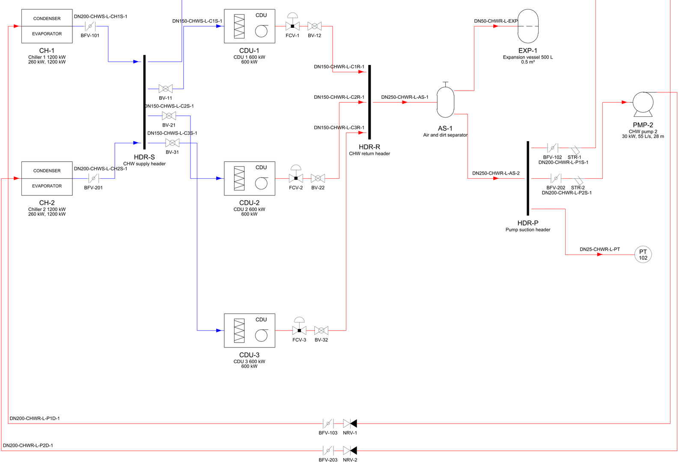
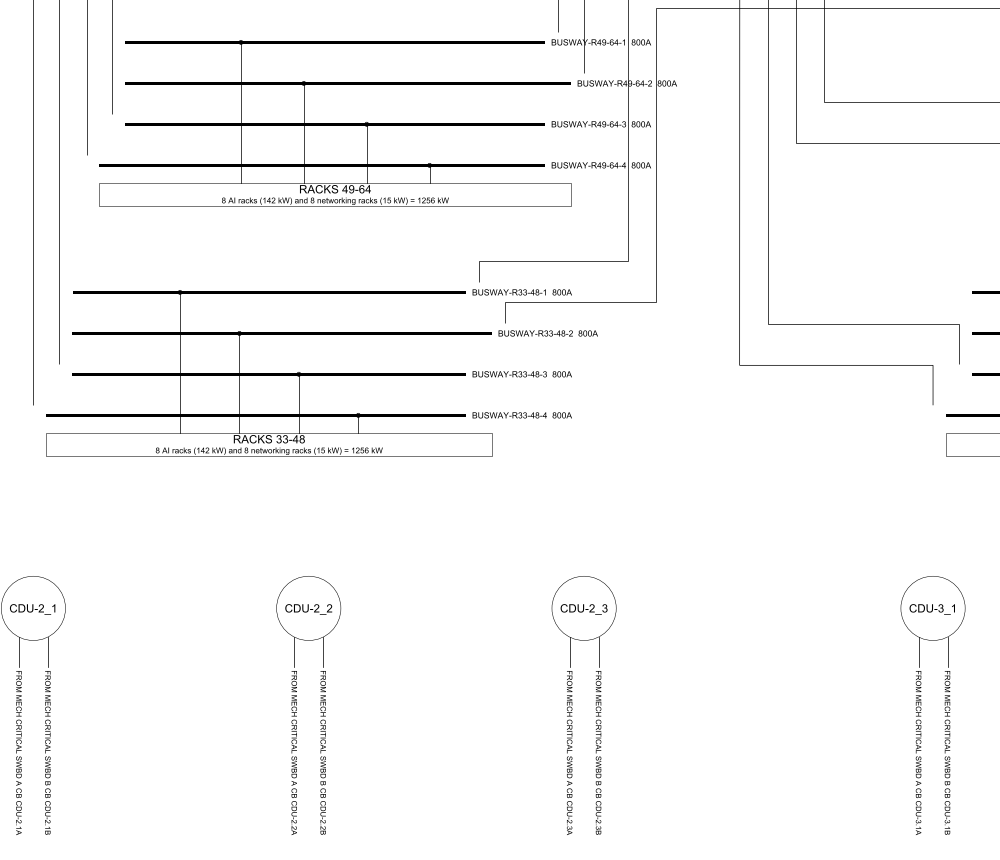

Every data centre has two drawings that everyone argues over: the
electrical single line diagram, which shows how power gets from the grid
to the racks, and the P&ID, which does the same for chilled water. They
are usually drawn by hand in CAD, and they drift from the design the
moment someone changes a breaker or adds a pump.

[IndustroML](https://sinkers.github.io/industroml/) is an open format for
describing that plant (switchboards, UPS, chillers, pumps, the cables and
pipes between them) as data that software and AI agents can read and
check. This month it learned to draw. The new
[`drawings/`](https://github.com/sinkers/industroml/blob/89a43a15d51eb07d19728263969c05c1bfe09d1d/drawings/README.md)
module turns a model into a formal SLD and P&ID, as DXF for CAD, PDF to
issue and PNG to review, so the drawing is regenerated from the model
instead of maintained beside it.

## What goes on a sheet

Each drawing sits on an ISO 5457 sheet, the smallest of A3 to A0 it fits
at full size, with a zoned border. The title block is filled from the
model's `meta.drawing` and the revision table from `meta.revisions`.
Missing fields stay blank. The legend lists only
the symbols that sheet uses, and the last note names the model file and
its SHA-256, so a print can be traced to the model that made it.

The DXF is AutoCAD 2013 format, in millimetres, drawn full size. Symbols
are blocks with attributes (`TAG`, `RATING`, `VOLTS`), so a value can be
edited in CAD without exploding anything, and every layer carries its own
colour, linetype and lineweight. FreeCAD's importer drops block
attributes, so `--flat` explodes the symbols into plain lines and text.

On the SLD, boards are busbars in dashed enclosures, with the protective
device on each feeder taken from the port's attributes. Each cable has its
construction and length written beside it, and HV is drawn in red. Symbols
follow IEC 60617 (AS/NZS 1102). The P&ID lays equipment out in flow order,
puts valves and strainers inline in the order the model connects them,
draws instruments as ISA-5.1 bubbles, and gives each service its own
layer and colour. Symbols follow ISO 10628-2.



*Part of the generated P&ID for the repo's invented data hall. Line numbers are `DN-service-id`.*

## Splitting over sheets

The first real project model I drew had four main boards, dual-fed
cooling boards and two chilled-water loops. On one sheet it was
unreadable. The SLD now splits the way a drafter would. A *final board*,
one whose circuits all end at loads, gets its own sheet, and its supplies
arrive at off-sheet connectors that name their sheet
("FROM MSB-A F-MECH, SHEET 1"). Everything above goes on an overall sheet.
If that overall sheet would still print below 0.6 scale, each main board
gets a sheet of its own too. The P&ID draws separate loops in their own
bands, and gives each loop its own sheet when the combined one would be
too small.

`--sheet A3` issues every sheet at one size, scaled to fit, because a set
issued at A3 is what people print.

## Drawn where the model says

Automatic layout suits a model of tens of items. I tested it by reading a
full reference-design P&ID (about 950 pipes, 350 valves, 330 tees) into a
model and drawing it back, and the automatic layout turned that into
spaghetti. So the schema gained optional positions: an asset can carry
`schematic: {at, size, rotation}` and a connection a `schematic.path`.
When every asset on a pipe is placed, the P&ID isn't laid out at all:

```yaml
assets:
- id: NRV-1
  kind: valve
  attributes: {valve_type: check}
  schematic: {at: [12.0, 40.0], rotation: 0}
connections:
- id: L-101
  type: pipe
  from: PMP-1.DISCHARGE
  to: NRV-1.IN
  attributes: {service: CHWS}
  schematic: {path: [[13.5, 40.0], [12.0, 40.0]]}
```

The read-back also showed what the schema couldn't hold. Tees and
flexible connections became asset kinds, and interfaces gained a role
(supply, return, suction, discharge and so on). A pipe with `dn_mm` is now
labelled with its size beside its longest run, but
[only if that run is long enough to carry the text](https://github.com/sinkers/industroml/blob/89a43a15d51eb07d19728263969c05c1bfe09d1d/drawings/pid.py#L651-L658).

## Reading RD110 back in

Schneider Electric publishes Reference Design 110, a 10 MW GB300 data
centre, including its electrical one-line as DXF.
[`importers/rd110`](https://github.com/sinkers/industroml/blob/89a43a15d51eb07d19728263969c05c1bfe09d1d/importers/rd110/README.md)
reads that drawing into a placed IndustroML model. Each variant comes out
as 168 breakers on 12 boards, 6 transformers, 6 generators, 14 UPS, 24
busways to 6 rack groups and 362 cables, each with its path on the sheet.
The drawing itself isn't in the repo; you download it from se.com.

Breakers are the only real blocks in that DXF. Everything else is
recognised from geometry and labels: boards are thick polylines,
transformers two overlapping circles, UPS dashed enclosures. Cables were
the fiddly part. RD110 draws a cable crossing another with a short break,
and a busway in two halves either side of its notes. The importer joins a
break only where the two ends face each other along one line, and treats
an end landing on the crossed cable as a crossing, not a tee.

It found one thing in the source. IT CRITICAL SWBD C has two breakers
labelled `AIIT-3.2C` and none labelled `AIIT-3.1C`. Both are kept, and the
second is flagged with a `check` attribute rather than quietly renamed.

The IT room then needed drawing the way the source draws it. A UPS is
drawn as its enclosure so the input, bypass and output cables land on it,
busway stacks drop into a rack-group box, interlocked transformer and
generator incomers are linked by an ATS, and fan walls and CDUs fed from
the mechanical sheet show each feed as "FROM <board> CB <breaker>". The
IT room fits on A0 and the mechanical plant on A2.



*Part of the redrawn RD110 IT room sheet: busway stacks into rack groups, and CDUs fed from another sheet.*

These drawings sit next to the
[pipe router in SD-DC](https://sinkers.github.io/devlog/2026/10/13/pipe-router/),
which already returns each routed pipe as an IndustroML connection. A
routed pipe plus a placed P&ID is the start of design to drawing without
a drafter redrawing it by hand.

## A validator that catches what it claims to

Before any of this, the validator needed fixing. Its duplicate-id check
ran on dicts keyed by id, which keep only the last of any repeat, so it
could never fire. It now reads the lists as written:

```python
for key, kind in (("containers", "container"), ("assets", "asset"),
                  ("interfaces", "interface"), ("connections", "connection")):
    seen: Set[str] = set()
    for x in model.get(key, []) or []:
        xid = x.get("id")
        if xid in seen:
            errs.append(f"Duplicate {kind} id: {xid}")
        seen.add(xid)
```
([validate_industroML.py L107–116](https://github.com/sinkers/industroml/blob/89a43a15d51eb07d19728263969c05c1bfe09d1d/validate_industroML.py#L107-L116))

It also checks each asset's kind against the domain the catalogue gives
it, so a pump in the electrical domain is caught. Each check now has a
test that breaks a model in exactly that way and expects the error.

The editor's 49 Jest tests now run in two seconds instead of seven
minutes. The fix wasn't in the code. The repo lived in iCloud Drive under
a path with spaces, which made git and Jest so slow the suite's output
never came back. Moving it out was the fix.

## What doesn't work yet

Automatic layout is reasonable, but no drafter. Cable text is
placed beside its line without collision checks, and on a crowded P&ID a
line number can still touch a line. The model has no port positions on
equipment and no protection settings, so neither is drawn. Control loops
stop at the instrument bubble, with no signal lines. The code is on
[GitHub](https://github.com/sinkers/industroml), though it has no licence
file yet.

---

*Originally published on [devlog](https://sinkers.github.io/devlog/2026/10/15/drawings/). The code is on [GitHub](https://github.com/sinkers/industroml).*
