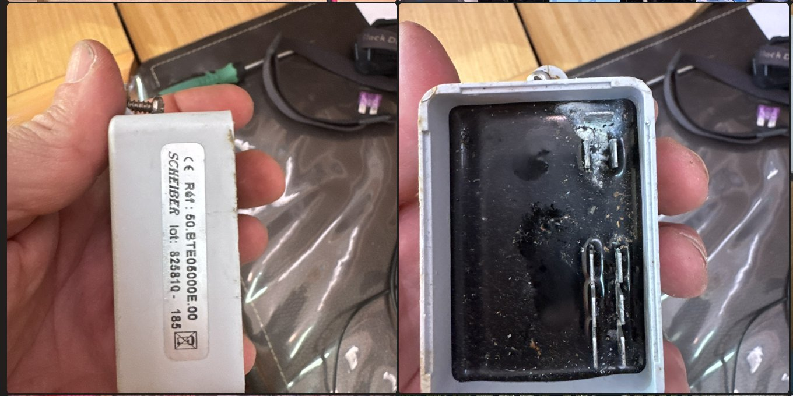
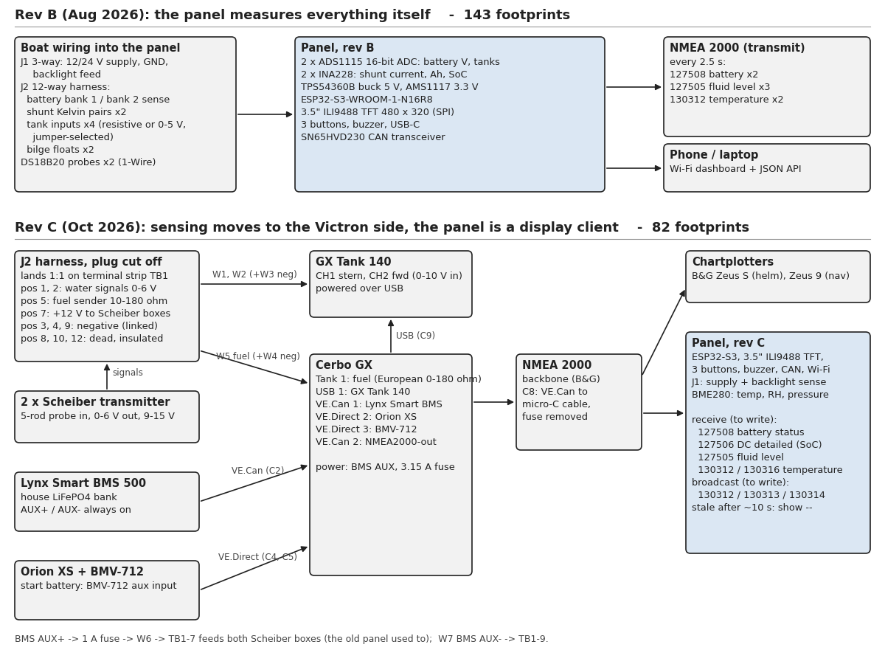
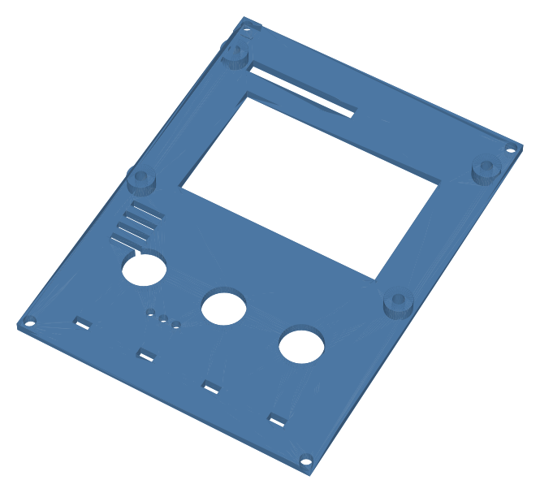
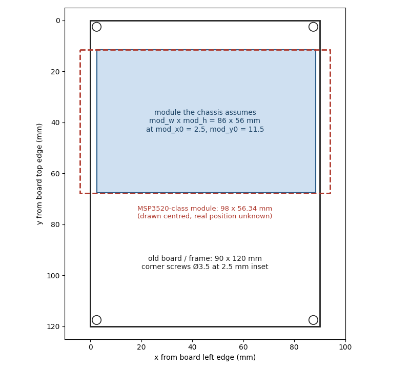

Production boats of the 2000s often have a small panel at the chart table
showing battery voltage and tank levels. The Siemens VDO "Batteries &
Levels" panel on a Beneteau First 45 has died, and I'm replacing it with
an ESP32-S3 and a 3.5" 480 × 320 ILI9488 TFT in the same 90 × 120 mm
frame. Three weeks and 32 commits in, the main result is a confirmed map
of the panel's 12-way harness, and a redesign that follows from it: the
panel no longer measures anything. All sensing moves to a Victron Cerbo
GX, and the panel board went from 143 footprints to 82. Nothing has been
built, printed or cut yet.

## The harness

The old panel takes a 3-way plug (supply, ground, backlight) and a
12-way TE Universal MATE-N-LOK. The map below was measured on 25 October,
system powered, positions top-left to right looking into the harness
plug.

| Pos | Wire | 25 Oct reading | Rev C: TB1 position n, then |
|---|---|---|---|
| 1 | Stern water signal | 2.3 V (¼ band) | W1 to GX Tank 140 CH1 |
| 2 | Fwd water signal | 1.2 V (empty band) | W2 to GX Tank 140 CH2 |
| 3, 4, 9 | Negative | | linked; W3, W4, W7 |
| 5 | Fuel sender, 10–180 Ω | 85 Ω, about 45 % | W5 to Cerbo Tank 1 |
| 6, 11 | Empty cavity | | unused |
| 7 | +12 V to both water transmitters | | W6 from BMS AUX+ via 1 A fuse |
| 8, 10, 12 | Red, old battery and shunt senses | 0 V (26 Oct) | insulated, labelled DEAD |

Each water tank has a Scheiber 50.BTE05000E.00 transmitter turning a
five-rod probe into 0–6 V, powered from pin 7. The drop-in replacement's
datasheet (50.BTE110009.00) gives the calibration steps: empty 1.0–1.2 V,
¼ 2.1–2.3, ½ 3.2–3.4, ¾ 4.35–4.55, full 5.5–5.7 V. Both readings sit in
a band, so both boxes work.



*One water transmitter as removed: the label, and the case opened to
show the resin potting. The factory manual lists a VDO part here.*

## What I got wrong first

The first visit, recorded 18 October, used a printed worksheet with the
panel unplugged (hero image, right; volts and ohms are in each other's
columns). Pins 3 and 4 read 36 Ω and pin 5 read 28 Ω, and I concluded all
three tanks had Euro 10–180 Ω senders.

The factory manual, found the same day, showed the water inputs are
0–6 V transmitter outputs fed 12 V by the panel. It also gave the shunt
as 100 A / 50 mV, where rev B assumed 500 A, and numbers the pins
differently from my worksheet.

The two visits still don't agree pin for pin. The first sheet has 0 Ω on
pins 1 and 2, 36 Ω on the two black wires at 3 and 4, and 12.8 V on pin
12. The powered map has water signals on 1 and 2, negatives on 3 and 4,
and 0 V on every red. The repo's factory-pinout note explains the 36 Ω
as unpowered transmitter outputs, which only holds if the two numberings
differ. I haven't photographed the moulded cavity numbers that would
settle it. Rev C doesn't depend on it, because every wire is labelled
and checked in place before the cut.

Fuel disagreed too, 28 Ω at the sender against 85 Ω at the plug: a
fault inside the sender, since fixed.

The three reds read 0 V against good negatives, the 1 A fuse is fine,
and they don't run straight to the batteries. I think they're taps
orphaned by earlier work, which would explain the old panel's dead
battery readings. I'm not tracing them: they're abandoned in place,
labelled, and treated as live when cut.

## Rev C: the panel becomes a display client

The boat is getting a Cerbo GX, Lynx Smart BMS, Orion XS and BMV-712
anyway. Once the harness was mapped, there was no reason for the panel
to measure anything the Cerbo can.



*Rev B from Fig. 1 of the repo's rev B design package and the firmware's
`sendN2k()`. Rev C from wiring Sheets 2 and 4 Rev 0.2 and the install
guide (commit 9293735). Footprint counts are the KiCad boards at 7950bab
and e43d660. Drawn with matplotlib.*

Water goes through a GX Tank 140 because the Cerbo's tank inputs are
resistive only. The transmitters are fed from BMS AUX through a 1 A fuse,
not the Tank 140's sender-power terminals, which put out 24 V against
their 9–15 V rating.

Rev B measured locally and transmitted. Its firmware sends this every
2.5 s; rev C has to receive the same PGNs instead:

```cpp
void sendN2k() {
    tN2kMsg msg;
    SetN2kDCBatStatus(msg, 0, S.bank_v[0], S.bank_a[0], N2kDoubleNA, 1);
    NMEA2000.SendMsg(msg);
    ...
    SetN2kFluidLevel(msg, 2, N2kft_Fuel, S.tank_pct[2], TANKS[2].capacity_l);
    NMEA2000.SendMsg(msg);
```

The panel gains a BME280 (temperature, humidity, pressure), which it
broadcasts.

## Chassis and screen size

The rev C board is placed, not routed, and optional. The first build is a
printed plate on the frame's corner screws holding off-the-shelf modules. It is modelled in OpenSCAD and not yet
printed.



*The front plate, rendered from the STL generated in commit f36bf26.*

The two screens arrived on 8 November and are larger than the model
assumed:

```
// ---- TFT module (KMRTM35018 / MSP3520 class) -- tune after measuring -
mod_x0 = 2.5;  mod_y0 = 11.5;          // module outline origin (board y, down)
mod_w  = 86;   mod_h  = 56;
```

The common MSP3520-class module is 98 × 56.34 mm, wider than the 90 mm
board it replaces.



*Board outline and screw holes from the chassis model's parameters; the
98 mm outline is the class figure, not a measurement of the arrived unit,
drawn centred because its real position is unknown.*

## Not done

- Nothing is built or printed.
- The arrived module and the frame cavity haven't been measured. Either
  the plate is re-laid or the screen changes; the firmware is unaffected.
- The plate's Ø12.4 mm holes suit panel-mount buttons; the ones coming
  are 12 mm square PCB tactiles.
- The firmware is still rev B. Receiving PGNs 127508, 127506, 127505 and
  130312/130316, marking data stale after about 10 s and showing "--",
  and broadcasting the BME280 are all unwritten.
- The harness isn't cut and the Cerbo isn't installed.

The obvious objection: the chartplotters will show all of this. They
will. The panel fills the nav-station frame the old one sat in, and adds
the barometer.

The repo is [on GitHub](https://github.com/sinkers/beneteau-f45-display)
under Apache 2.0. Only the licence commit is pushed; the other 31 commits
are local.
