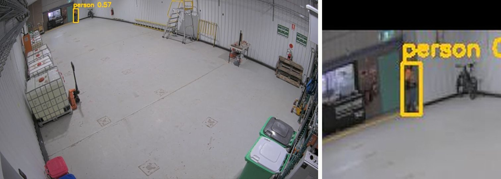

[cvkit](https://cvkit.net/) is an open-source toolkit for security cameras.
A small object detector runs next to the cameras, on a Raspberry Pi 5 with a
Hailo-8L accelerator, and only sends a detection upstream when something
has moved. Detectors like that confuse a hi-vis vest on a hook with a
person, so before anyone is alerted, a vision model looks at the detection
and says whether it is real.

Which model? I built a benchmark to decide, and it now runs once a month.
Each run sends 78 labelled detections to 21 models through OpenRouter. That
is 1,638 calls, for $2.40.

## What it found

| model | quality /10 | real events confirmed | false alarms rejected | $ per 1,000 checks |
|---|---|---|---|---|
| gemini-3.5-flash-lite | 10.0 | 100% | 100% | 0.89 |
| claude-haiku-5.5 | 9.85 | 100% | 96% | 0.29 |
| deepseek-v4.1-flash | 9.83 | 100% | 96% | 0.10 |
| glm-5.3-flash | 9.73 | 96% | 100% | 0.10 |

The service now uses deepseek-v4.1-flash: the cheapest model close to the
best that confirmed every real event. At 1,000 checks a day it costs about
$0.10 a day.

## Two runs, two picks

The morning run picked glm-5.3-flash. The evening run, with the same cases,
the same prompt and temperature 0, had it calling the person above "orange
hi-vis clothing hanging by the green door frame". It still met the bar, but
deepseek-v4.1-flash had improved and came in $0.002 per 1,000 checks
cheaper. With 53 real cases, one miss moves recall by 1.9 points, so a
single pass can't separate models this close. The next step is repeating
each case before the service switches models.

All 78 images, with every model's answer to each, are on the
[method page](https://cvkit.net/resources/reports/vision-benchmark/2026-11-26/method.html). That
page also covers the limits: one site, daylight only, mostly one person.

The full write-up, with the scoring code and the bugs I found along the way,
is on my devlog:

https://sinkers.github.io/devlog/2026/11/26/vision-benchmark/

The code is MIT on [GitHub](https://github.com/cvkitio/edge).
